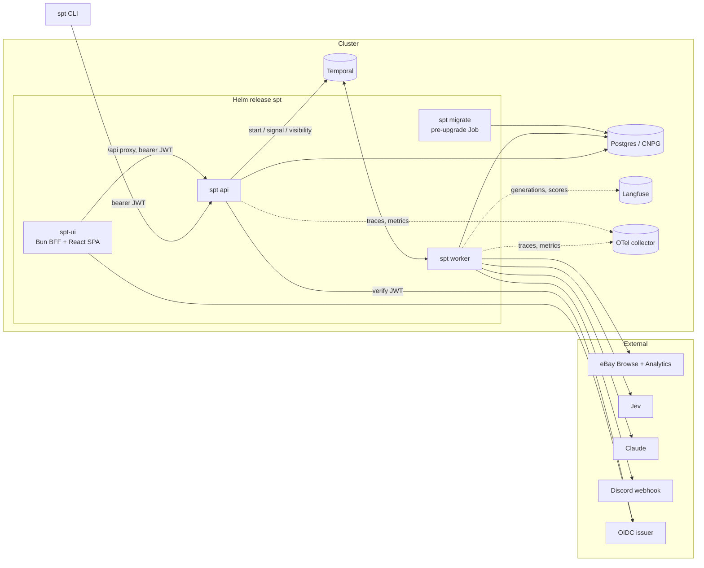
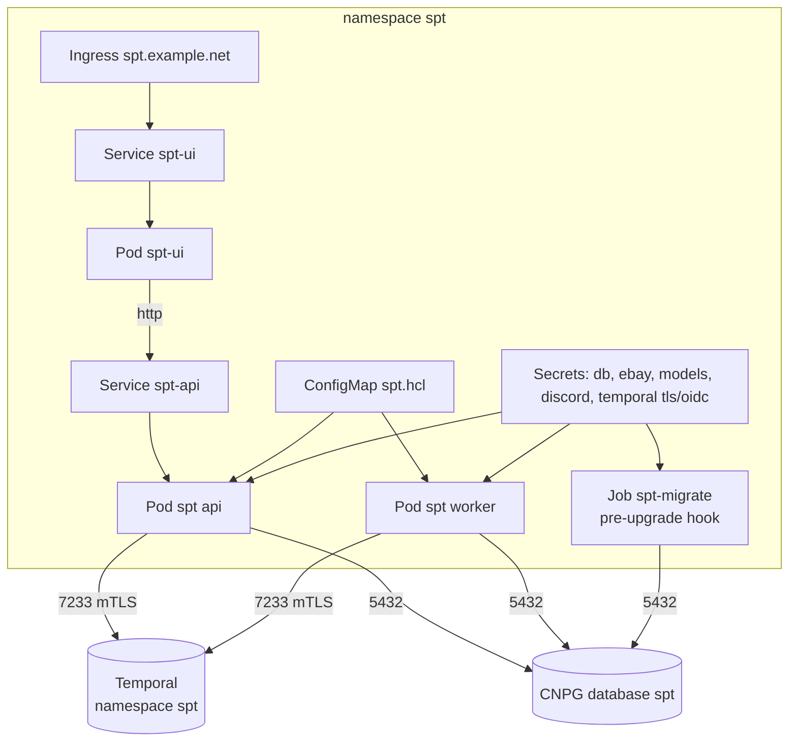
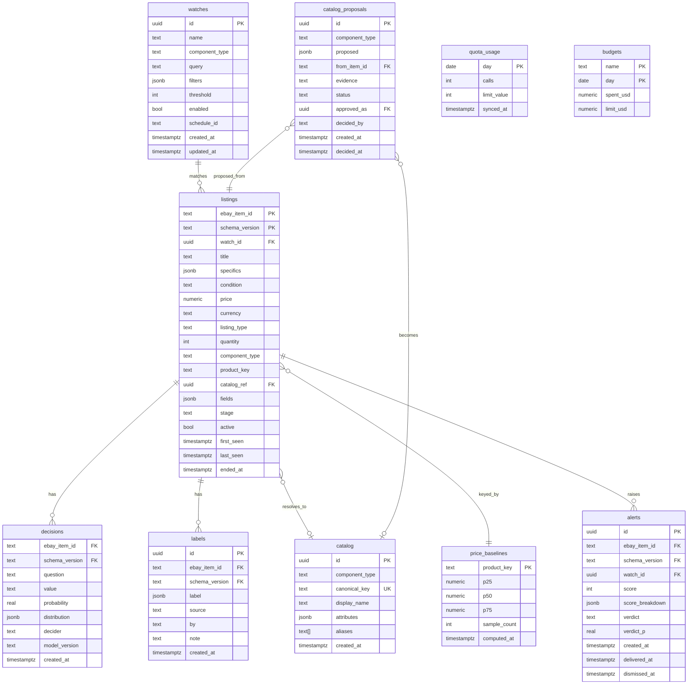

<!-- markdownlint-disable-file MD025 MD041 -->

# DESIGN-0001: System architecture: roles, configuration, deployment and data model

<!--toc:start-->
<!-- markdownlint-capture -->
<!-- markdownlint-disable MD013 -->
- [Overview](#overview)
- [Goals and Non-Goals](#goals-and-non-goals)
  - [Goals](#goals)
  - [Non-Goals](#non-goals)
- [Background](#background)
- [Detailed Design](#detailed-design)
  - [Components](#components)
  - [The binary and its roles](#the-binary-and-its-roles)
  - [Repository layout](#repository-layout)
  - [Configuration](#configuration)
  - [Deployment](#deployment)
  - [Observability](#observability)
  - [Testing and development harness](#testing-and-development-harness)
- [API / Interface Changes](#api--interface-changes)
- [Data Model](#data-model)
- [Testing Strategy](#testing-strategy)
- [Migration / Rollout Plan](#migration--rollout-plan)
- [Open Questions](#open-questions)
- [References](#references)
<!-- markdownlint-restore -->
<!--toc:end-->

<!--docz:overview:start-->
## Overview

This document is the map of spt as a running system: the processes and
what each one does, how the one binary is split into roles, the
configuration file and environment contract, how the Helm chart deploys
it, what is observable, and what Postgres holds. It is the document the
other designs hang off: DESIGN-0002 fills in the workflows, DESIGN-0003
through DESIGN-0005 the extraction middle, DESIGN-0006 the API and
DESIGN-0007 the UI.

<!--docz:overview:end-->

## Goals and Non-Goals

<!--docz:goals:start-->
### Goals

- One Go binary, one chart, one release tag; roles are a subcommand and a
  chart value.
- The api role never links workflow code; the worker never serves the
  API. The boundary is enforced by the linter, not by convention.
- Every setting an operator edits is in one HCL file; every secret and
  every per-deployment value is in the environment.
- Dev and prod are two releases of the same chart against two Temporal
  namespaces and two databases, differing only in values.
- Postgres holds business facts only. No table exists for the pipeline to
  poll.
- Health, metrics, traces and model-call records are emitted the same way
  the other services on the cluster emit them.

<!--docz:goals:end-->

<!--docz:non-goals:start-->
### Non-Goals

- Multi-tenancy. One operator, one eBay application, one Discord channel.
- Horizontal scale beyond one api replica and a few worker replicas.
- Any storage other than Postgres. No cache, no object store, no second
  database.
- Running without Temporal. Development uses the Temporal CLI dev server.

<!--docz:non-goals:end-->

<!--docz:background:start-->
## Background

RFC-0001 states the product and the principles. ADR-0002 draws the
Temporal and Postgres boundary and the two roles. ADR-0005 chooses HCL
for configuration and the `TEMPORAL_*` environment for the connection.
ADR-0006 and ADR-0007 decide the API and the UI, which are separate
processes from the worker.

The repository is a forge-templated Go service: `cmd/spt` with a thin
main, `internal/` for library code, a distroless multi-stage Dockerfile
with `VERSION`, `COMMIT` and `DATE` build arguments, `docker-bake.hcl`
with `spt`, `spt-ci` and `spt-release` targets, a chart under
`charts/spt` with a single Deployment that manages `LISTEN_ADDR`,
`METRICS_ADDR`, `LOG_LEVEL` and `POD_NAME` and refuses to render when
`configMap.data`, `secrets.stringData` or `extraEnv` collide with those
names, a `justfile` with `check`, `build`, `docker-build`, `helm-test`
and `k3d-install`, and a release train that tags on merge from the PR's
semver label and publishes binary, image and chart at the same version.
This design keeps all of it and adds roles, a second Deployment, a UI
Deployment, a migration Job and the Temporal and database values.

The other Temporal services on the cluster (repo-guardian, boop) are the
reference for the role split, the worker boot order, the `TEMPORAL_*`
environment, the chart's `temporal:` values and the health endpoints.
The first implementation of this product is the reference for the eBay
client, the Discord notifier, the composite scorer and the shape of the
watches, listings, baselines and alerts tables.

<!--docz:background:end-->

<!--docz:detailed-design:start-->
## Detailed Design

### Components



| Process | Image | Listens | Talks to |
| --- | --- | --- | --- |
| `spt api` | `ghcr.io/donaldgifford/spt` | HTTP on `LISTEN_ADDR`; health and metrics on `METRICS_ADDR` | Postgres (read and write), Temporal (client), OIDC issuer (JWKS) |
| `spt worker` | `ghcr.io/donaldgifford/spt` | health and metrics on `METRICS_ADDR` only | Temporal (worker), Postgres, eBay, Jev, Claude, Discord, Langfuse |
| `spt migrate` | `ghcr.io/donaldgifford/spt` | nothing | Postgres |
| `spt-ui` | `ghcr.io/donaldgifford/spt-ui` | HTTP on `PORT` | OIDC issuer, `spt api` |

### The binary and its roles

```text
spt
├── api                  serve the API (DESIGN-0006)
├── worker               host workflows and activities (DESIGN-0002)
├── all                  api + worker in one process (development default)
├── migrate [--check]    apply embedded migrations, or exit non-zero if any are pending
├── config  validate <file>
├── registry validate | diff <ref> | version
├── catalog  seed --from-v1 <dsn> | list | approve <id> | reject <id>
├── watches  list | create | update | enable | disable | delete
├── listings list | get | label
├── alerts   list | get | dismiss | restore
├── runs     list | journal <workflow-id>
├── decisions calibration [--since] | stats
├── ingest   [--watch] [--full] [--schema-version] | cancel <workflow-id>
├── decide   --registry <file> <item-id | --state file>
└── version
```

Role subcommands build their dependencies and block until SIGTERM. Client
subcommands use the generated API client against `SPT_API_URL` with a
bearer token from `SPT_TOKEN` or the OIDC device flow. The two groups
share only `internal/config` and the generated client types.

Boot order per role:

```mermaid
sequenceDiagram
    participant M as main
    participant C as config
    participant S as store
    participant T as temporal
    participant H as health

    M->>C: load spt.hcl + env, validate (fatal on error)
    M->>C: load registry, validate (fatal on error)
    M->>H: start /healthz on METRICS_ADDR
    M->>S: open pool; migrate --check (fatal if pending)
    alt role api
        M->>T: dial client (mTLS/OIDC), version check
        M->>M: build ServeMux, listen on LISTEN_ADDR
    else role worker
        M->>T: dial client, ensure search attributes
        M->>T: register workflows + activities, start workers
        M->>T: promote build; ensure baseline + catalog-review Schedules
    end
    M->>H: mark /readyz ready (Temporal ping, current version, Postgres ping)
    Note over M: SIGTERM → stop accepting, drain for WorkerStopTimeout, exit
```

The api role imports `internal/workflows/names` (string constants for
workflow types, signal names, task queues and search attributes) and
nothing else from the workflow tree. A depguard rule in `.golangci.yml`
denies `internal/workflows` and `internal/activities` to `internal/api`
and `cmd/spt/api*.go`.

### Repository layout

```text
api/                      openapi.yaml, oapi-codegen.yaml, vacuum.yaml
cmd/spt/                  main.go; one file per subcommand group
internal/
  api/                    server, handlers per resource, gen/, client/, problem, cursor, authn, authz, middleware
  config/                 hclkit loader, defaults, validators, env overrides
  store/                  pgx store; migrations/ (embedded Goose SQL); migrate.go
  ebay/                   Browse client, token provider, Analytics quota sync, fixtures
  notify/                 Discord notifier (embeds, chunking, bucket-aware retry)
  observability/          OTel SDK setup, Prometheus bridge, slog handler
  health/                 /healthz, /readyz, /metrics on METRICS_ADDR
  temporal/               Config, Dial, worker, deployment, schedules, searchattributes, metrics, temporaltest
  workflows/              names/ (constants), options.go, register.go, ingest.go, extract.go, baseline.go, catalogreview.go
  activities/             one struct per group: ebay, decide, resolve, persist, score, notify, escalate, catalog
  domain/                 listing, watch, decision, label, alert, proposal types
pkg/
  decide/                 Decider contract; jev/, claude/, ollama/, mock/, cascade/; escalator
  registry/               registry.hcl (embedded), loader, validator, keytemplate
  resolve/                catalog retrieval and chooser
  scorer/                 composite score
  langfuse/               ingestion client
tools/                    dashgen, mock-ebay, dataset-export, regression-runner
ui/                       server/ (BFF), web/ (SPA), e2e/, scripts/
charts/spt/               chart, tests/, values.schema.json, dashboards/
testdata/                 golden dataset, eBay fixtures, Jev and Claude wire fixtures, replay histories
docs/                     docz
```

`pkg/` holds packages with no dependency on the store or Temporal:
contracts and pure functions that the regression runner and the tools
import. `internal/` holds everything with a side effect.

### Configuration

`spt.hcl` is decoded by `internal/config` with hclkit (ADR-0005). Full
example with defaults:

```hcl
server {
  listen_addr      = ":8080"   # overridden by LISTEN_ADDR
  metrics_addr     = ":9090"   # overridden by METRICS_ADDR
  read_timeout     = "10s"
  write_timeout    = "30s"
  shutdown_timeout = "30s"
}

database {
  dsn              = env("DATABASE_URL")   # secret: must be env()
  max_conns        = 10
  statement_timeout = "30s"
}

ebay {
  client_id      = env("EBAY_CLIENT_ID")       # secret
  client_secret  = env("EBAY_CLIENT_SECRET")   # secret
  marketplace    = "EBAY_US"
  base_url       = "https://api.ebay.com"
  pages_per_tick = 5
  page_size      = 200
  daily_quota    = 5000
  quota_reserve  = 0.10        # fraction kept back for manual ingests
}

decide {
  cascade            = ["jev", "haiku"]
  budget_usd_per_day = 5.00

  # Decision model, direct from TypeSafe. Pinned to a version so a
  # calibration run names the model it measured.
  decider "jev" {
    kind     = "jev"
    api_key  = env("JEV_API_KEY")               # secret (TypeSafe platform)
    base_url = "https://api.typesafe.ai"
    model    = "jev-1.14.0"
    timeout  = "10s"
  }

  # Text models answer the same question set through one compiled schema.
  decider "haiku" {
    kind       = "anthropic"
    api_key    = env("ANTHROPIC_API_KEY")       # secret
    base_url   = "https://api.anthropic.com"
    model      = "claude-haiku-5-5"
    timeout    = "30s"
    max_tokens = 1024
  }

  decider "sonnet-opencode" {
    kind     = "anthropic"
    api_key  = env("OPENCODE_API_KEY")          # secret
    base_url = "https://opencode.ai/inference/anthropic"
    model    = "claude-sonnet-5-5"
    enabled  = false
  }

  decider "gpt-mini-opencode" {
    kind     = "openai"
    api_key  = env("OPENCODE_API_KEY")          # secret
    base_url = "https://opencode.ai/inference/openai"
    model    = "gpt-5.4-mini"
    enabled  = false
  }

  decider "ollama" {
    kind     = "ollama"
    base_url = "http://ollama.ai.svc:11434"
    model    = "qwen3:8b"
    enabled  = false
  }

  # Cross-check: a sample of listings is also answered by these deciders
  # and disagreements are recorded (DESIGN-0003).
  cross_check {
    deciders        = ["haiku"]
    sample          = 0.10
    on_disagreement = "log"     # log | escalate
  }
}

escalate {
  model              = "claude-haiku-5-5"
  api_key            = env("ANTHROPIC_API_KEY")   # secret
  budget_usd_per_day = 3.00
  timeout            = "60s"
  description_max_chars = 4000
}

scoring {
  window_days          = 90
  min_baseline_samples = 5
  weights {
    price     = 0.50
    seller    = 0.15
    condition = 0.15
    quantity  = 0.10
    quality   = 0.10
  }
}

catalog {
  similarity_threshold = 0.3
  candidate_limit      = 50
  match_threshold      = 0.70
}

notify {
  discord_webhook   = env("DISCORD_WEBHOOK_URL")   # secret
  inter_chunk_delay = "1s"
  summary_only      = false
}

observability {
  otlp_endpoint     = "http://otel-collector.observability.svc:4317"
  langfuse_base_url = "https://langfuse.example.net"
  langfuse_public_key = env("LANGFUSE_PUBLIC_KEY")   # secret
  langfuse_secret_key = env("LANGFUSE_SECRET_KEY")   # secret
  log_level  = "info"     # overridden by LOG_LEVEL
  log_format = "json"
}

workflows {
  watch_interval          = "15m"
  watch_jitter            = "2m"
  tick_deadline           = "10m"
  max_concurrent_children = 20
  label_timeout           = "168h"
  proposal_timeout        = "336h"
  baseline_interval       = "1h"
  catalog_review_cron     = "0 9 * * *"
}

queue "ebay"     { activities_per_second = 2 }
queue "decide"   { max_concurrent = 16 }
queue "escalate" { max_concurrent = 4 }
queue "notify"   { activities_per_second = 1 }
queue "default"  { max_concurrent = 32 }
```

Loader rules:

- Defaults are applied in Go before decoding, so an empty file is valid.
- `env()` is the only function beyond hclkit's standard set. Fields
  tagged secret reject any expression that is not an `env()` call.
- Durations are hclkit `ctytypes.Duration`; `kind` is an enum.
- Validators: cascade entries name declared deciders; at least one decider
  is enabled; budgets are non-negative; queue names are the known set;
  intervals are within bounds. All diagnostics are returned together with
  positions.
- `LISTEN_ADDR`, `METRICS_ADDR`, `LOG_LEVEL` override their fields after
  decoding; `POD_NAME` becomes the worker identity suffix.
- `spt config validate <file>` runs the loader with a fake environment in
  which every `env()` resolves, so CI can validate the chart's rendered
  ConfigMap without secrets.

Environment contract, in full:

| Variable | Set by | Used by |
| --- | --- | --- |
| `LISTEN_ADDR`, `METRICS_ADDR`, `LOG_LEVEL`, `POD_NAME` | chart (existing contract) | both roles |
| `DATABASE_URL` | `database.existingSecret` | both roles, migrate |
| `EBAY_CLIENT_ID`, `EBAY_CLIENT_SECRET`, `DISCORD_WEBHOOK_URL`, `JEV_API_KEY`, `OPENCODE_API_KEY`, `ANTHROPIC_API_KEY`, `OPENAI_API_KEY`, `LANGFUSE_PUBLIC_KEY`, `LANGFUSE_SECRET_KEY` | `secrets.stringData` or an existing Secret; locally the spt 1Password Environment | worker |
| `OIDC_ISSUER`, `OIDC_AUDIENCE`, `OIDC_OPERATOR_GROUP` | `api.auth` values | api |
| `TEMPORAL_ADDRESS`, `TEMPORAL_NAMESPACE`, `TEMPORAL_TASK_QUEUE_PREFIX` | `temporal:` values | both roles |
| `TEMPORAL_TLS_CERT_FILE`, `TEMPORAL_TLS_KEY_FILE`, `TEMPORAL_TLS_CA_FILE`, `TEMPORAL_TLS_SERVER_NAME` | `temporal.tls` mounted Secret | both roles |
| `TEMPORAL_OIDC_ISSUER`, `TEMPORAL_OIDC_CLIENT_ID`, `TEMPORAL_OIDC_CLIENT_SECRET`, `TEMPORAL_OIDC_AUDIENCE` | `temporal.auth.oidc` | both roles |
| `TEMPORAL_BUILD_ID` | chart, from the image tag | worker |

### Deployment

The chart grows from one Deployment to the release shown above. Values
added or changed:

```yaml
topology: split            # split | all

api:
  replicas: 1
  resources: {}
  auth:
    issuer: https://sso.example.net
    audience: spt
    operatorGroup: spt-operators
  ingress:
    enabled: false         # the UI fronts the API; expose only for CLI use

worker:
  replicas: 1
  resources: {}
  stopTimeout: 60s

ui:
  enabled: true
  image: { repository: ghcr.io/donaldgifford/spt-ui, tag: "" }
  replicas: 1
  publicUrl: https://spt.example.net
  oidc: { issuer: ..., clientId: spt-ui, existingSecret: spt-ui-oidc }
  sessionKeysSecret: spt-ui-session
  ingress: { enabled: true, className: ..., hosts: [...], tls: [...] }
  links: { temporalUi: https://temporal.example.net, langfuse: https://langfuse.example.net }

temporal:
  address: temporal-frontend.temporal.svc:7233
  namespace: spt
  taskQueuePrefix: spt
  tls: { enabled: true, existingSecret: spt-temporal-tls }
  auth:
    oidc: { enabled: true, issuer: ..., clientId: spt, existingSecret: spt-temporal-oidc, audience: temporal }

database:
  existingSecret: spt-db-app   # key DATABASE_URL

config:
  file: |                      # spt.hcl, rendered into a ConfigMap and mounted at /etc/spt/spt.hcl
    ...

migrate:
  enabled: true                # pre-install,pre-upgrade hook Job running `spt migrate`
```

Rendering rules:

- `topology: split` renders `deployment-api.yaml` and
  `deployment-worker.yaml` with `args: [api]` and `args: [worker]`;
  `topology: all` renders one Deployment with `args: [all]`. Both
  Deployments mount the same ConfigMap and the same Secrets; only the
  worker mounts the model and notifier secrets.
- The existing `validateEnvCollisions` helper extends to the new managed
  names (`DATABASE_URL`, `TEMPORAL_*`, `OIDC_*`).
- `spt migrate` runs as a Helm hook Job before install and upgrade, with
  `hook-delete-policy: before-hook-creation,hook-succeeded`. Both roles
  also run `migrate --check` at start and refuse to serve on pending
  migrations.
- A ServiceMonitor per role; the PrometheusRule gains worker and
  pipeline alerts (see Observability).
- Dev and prod are two releases (`spt-dev`, `spt`) with different
  `temporal.namespace`, `database.existingSecret` and `ui.publicUrl`.
  Nothing else differs.
- `docker-bake.hcl` gains `ui`, `ui-ci` and `ui-release` targets; the
  release workflow pushes both images at the tag and the chart's
  `appVersion` covers both.



### Observability

| Signal | Source | Sink |
| --- | --- | --- |
| Logs | slog JSON on stdout, `LOG_LEVEL`; workflow and activity logs via the SDK's slog adapter with workflow ID and run ID fields | cluster log pipeline |
| Traces | `otelhttp` on the api; the Temporal OpenTelemetry tracing interceptor on client and worker; `otelpgx` on the pool; one span per outbound call | OTLP to the collector |
| Metrics | SDK metrics through the OpenTelemetry contrib handler and the Prometheus exporter on `METRICS_ADDR/metrics`; app metrics listed below | ServiceMonitor |
| Model calls | one Langfuse trace per listing (session = workflow ID), one generation per decider or escalator call, scores from operator actions | Langfuse ingestion API |

App metrics, pinned by an exact-set test and consumed by `tools/dashgen`:

| Metric | Type | Labels |
| --- | --- | --- |
| `spt_activity_duration_seconds` | histogram | `activity`, `outcome` |
| `spt_ingest_items_total` | counter | `watch`, `result` (`new`, `seen`, `error`) |
| `spt_decide_confidence` | histogram | `question`, `decider` |
| `spt_decide_fallback_total` | counter | `from`, `to` |
| `spt_decide_cost_usd_total` | counter | `decider` |
| `spt_escalation_total` | counter | `reason` |
| `spt_awaiting_label` | gauge | — |
| `spt_catalog_proposals_pending` | gauge | — |
| `spt_ebay_quota_used` | gauge | — |
| `spt_alerts_total` | counter | `watch`, `verdict` |
| `spt_notify_batches_total` | counter | `result` |
| `spt_baseline_keys` | gauge | `component_type` |
| `spt_budget_remaining_usd` | gauge | `budget` |

PrometheusRule additions: worker not polling (SDK poll counter flat for
10 minutes), task-queue backlog growing for 30 minutes, decide fallback
rate above 20% for an hour, escalation rate above 15% for a day, eBay
quota above 90%, a budget below 10%, `spt_awaiting_label` above 50,
baseline refresh overdue by two intervals.

### Testing and development harness

- `just test`: unit tests with no services. Workflows under the SDK test
  suite, activities with mockery v3 mocks, config and registry loaders
  table-driven, API handlers against the strict-server interface, a role
  registration test, the metric-set test.
- `just test-integration` (tag `integration`): the Temporal CLI dev
  server through `temporaltest.Start(t)`, Postgres through
  testcontainers, the eBay mock server, recorded model fixtures.
- `just test-regression`: the golden dataset through each decider
  (DESIGN-0003).
- `just dev`: compose with Postgres and the Temporal dev server, then
  `op run --environment <spt-env-id> -- spt all --config dev.hcl
  --insecure-no-auth`. The model, eBay, Discord and Langfuse keys live in
  the spt 1Password Environment and are injected for the process only;
  nothing is written to a `.env` file. CI uses a 1Password service
  account scoped to that Environment for the live-model regression job.
- `just k3d-install`: both images into k3d, the chart with
  `topology: all`, Temporal dev server and Postgres as chart
  dependencies enabled by a dev values file.
- `just e2e` (tag `e2e`): a full tick on k3d against the mock eBay
  server, asserting Discord embeds through a capture endpoint.

<!--docz:detailed-design:end-->

<!--docz:api-changes:start-->
## API / Interface Changes

- CLI: the subcommand tree above. `spt serve` from the scaffold is
  replaced by `spt api`, `spt worker` and `spt all`.
- Configuration: `spt.hcl` as specified; the chart's `config.file` value
  renders it.
- Chart: `topology`, `api`, `worker`, `ui`, `temporal`, `database`,
  `migrate` values; two or three Deployments; a hook Job; per-role
  ServiceMonitors; new PrometheusRule entries; `values.schema.json`
  updated; helm-unittest suites for each topology and for the collision
  helper.
- Images: `ghcr.io/donaldgifford/spt` (unchanged name) and
  `ghcr.io/donaldgifford/spt-ui` (new), both at the release tag.
- Health: `/healthz` is liveness (process up); `/readyz` is readiness
  (config and registry loaded, migrations current, Postgres ping,
  Temporal ping, and for the worker the current build is promoted).
- The HTTP API itself is DESIGN-0006.

<!--docz:api-changes:end-->

<!--docz:data-model:start-->
## Data Model



Rules:

- `listings` is keyed by item ID and registry version. A new registry
  version produces a new row with its own decisions; the UI shows the
  newest and links older ones.
- `listings.stage` mirrors the workflow's `SptStage` search attribute
  for SQL joins; it is written by the workflow after each transition and
  is never polled.
- `listings.active` is maintained by the baseline refresh: an item not
  seen in the trailing two ticks of its watch is marked inactive with
  `ended_at`, and baselines exclude inactive rows.
- `decisions` is append-only and is both the audit trail and the
  calibration dataset.
- `labels` is append-only. `source` is `operator`, `escalate` or
  `dismiss`; `by` is the OIDC subject or the model name.
- `quota_usage` and `budgets` are incremented in the same transaction as
  the activity result they account for (`persist` writes the decision
  rows and the spend in one statement batch).
- No `CHECK` on `component_type`; the registry validates. No table has a
  column that a loop polls.
- Indexes: `listings (watch_id, last_seen)`, `listings (stage)`,
  `listings (product_key) where active`, `decisions (ebay_item_id,
  schema_version)`, `alerts (created_at desc) where dismissed_at is
  null`, `catalog using gin (display_name gin_trgm_ops)`, `catalog using
  gin (aliases)`, `catalog_proposals (status)`.

Migrations are Goose SQL files embedded under `internal/store/migrations`
starting at `001`, run by `spt migrate` and checked by both roles at
start. Extensions required: `pg_trgm`. The database is created by CNPG
with the `app` user owning the schema.

<!--docz:data-model:end-->

<!--docz:testing:start-->
## Testing Strategy

- Config loader: table-driven tests for defaults, `env()` resolution, the
  secret guard, every validator, and a golden test of the example file.
- Chart: helm-unittest suites for `topology: split` and `all`, the UI
  Deployment on and off, the migrate hook, the collision helper with the
  new names, and `values.schema.json` acceptance of the dev and prod
  values files; `ct lint` in CI.
- Roles: a test that `spt api` registers no workflows and `spt worker`
  serves no API routes; the depguard rule in `just lint`.
- Store: integration tests on testcontainers Postgres for every upsert's
  idempotency, the transactional counter increments, and the
  pending-migration check.
- Health: readiness flips only when every dependency check passes.
- Metrics: the exact-set test; dashgen output is committed and checked
  for drift.

<!--docz:testing:end-->

<!--docz:rollout:start-->
## Migration / Rollout Plan

1. Repository: roles, config loader, store and migrations, health,
   observability, chart changes. Everything runs under `spt all` against
   the dev server and compose Postgres with mock deciders (RFC-0001
   phase 1).
2. Cluster dev: Temporal namespace `spt-dev`, CNPG database `spt_dev`,
   release `spt-dev` with `topology: split`, Temporal auth by OIDC
   client-credentials over mTLS, real eBay at a quota reserve of 75%.
3. Two-week labelled soak on all watches in `spt-dev`, then prod:
   namespace `spt`, database `spt`, release `spt`. The first
   implementation no longer runs; its database is read once to seed the
   catalog (IMPL-0004).

<!--docz:rollout:end-->

<!--docz:open-questions:start-->
## Open Questions

All questions below were decided on 2026-11-06; the chosen option is
recorded and the alternatives are dropped. The body of the design
reflects the decision.

**Q1. Temporal client authentication for both roles.** Decided (2026-11-06): option a.
The cluster's existing pattern: OIDC client-credentials bearer over mTLS with OpenBao-issued certificates, reloaded on rotation. Same chart values and shared package as the other services.

**Q2. Worker deployment versioning from the first dev deployment?** Decided (2026-11-06): option a.
Yes. Promotion and the readiness check cost nothing and make every rollout during integration safe for in-flight listings.

**Q3. Where does the Postgres database live?** Decided (2026-11-06): option a.
A new database on the existing CNPG cluster, one per environment (`spt_dev`, `spt`), owned by an `app` user per database.

**Q4. How are migrations applied?** Decided (2026-11-06): option a.
A Helm pre-install and pre-upgrade hook Job running `spt migrate`, plus `migrate --check` at role start as a guard.

**Q5. OpenTelemetry export path.** Decided (2026-11-06): option a.
OTLP to the cluster's collector, which fans out to the trace backend and to Langfuse's OTLP endpoint; the Langfuse ingestion client is used only for scores and dataset runs.

**Q6. One chart or two?** Decided (2026-11-06): option a.
One chart with `ui.enabled`; the UI image releases at the same tag.

**Q7. Where is the golden dataset today?** Decided (2026-11-06): option a.
In Langfuse as a dataset; export it into `testdata/golden/` in phase 1 and keep Langfuse for recording dataset runs.

<!--docz:open-questions:end-->

<!--docz:references:start-->
## References

- [RFC-0001 spt: durable execution of typed decisions over watched eBay listings](../rfc/0001-spt-durable-execution-of-typed-decisions-over-watched-ebay.md)
- [ADR-0002 Temporal is the execution plane; Postgres is the system of record](../adr/0002-temporal-is-the-execution-plane-postgres-is-the-system-of-record.md)
- [ADR-0005 Configuration is HCL decoded with hclkit](../adr/0005-configuration-is-hcl-decoded-with-hclkit.md)
- [ADR-0006 The API is a spec-first OpenAPI contract served on net/http](../adr/0006-the-api-is-a-spec-first-openapi-contract-served-on-nethttp.md)
- [ADR-0007 The operator UI is a React SPA behind a Bun BFF](../adr/0007-the-operator-ui-is-a-react-spa-behind-a-bun-bff.md)
- [DESIGN-0002 Durable execution](../design/0002-durable-execution-workflows-activities-queues-and-signals.md); [DESIGN-0006 API](../design/0006-api-the-openapi-contract-authentication-and-clients.md); [DESIGN-0007 Operator UI](../design/0007-operator-ui-alerts-review-catalog-and-runs.md)
- [repo-guardian DESIGN-0026 v2 Temporal control plane and role split](https://github.com/donaldgifford/repo-guardian/blob/main/docs/design/0026-v2-temporal-control-plane-and-role-split.md); [DESIGN-0028 Temporal client auth](https://github.com/donaldgifford/repo-guardian/blob/main/docs/design/0028-temporal-client-auth-oidc-over-mtls-with-openbao-issued.md); [`charts/repo-guardian`](https://github.com/donaldgifford/repo-guardian/tree/main/charts/repo-guardian)
- [boop `internal/temporal`](https://github.com/donaldgifford/boop/tree/main/internal/temporal); [boop ADR-0004 No CRDs: configuration from a chart-shipped file](https://github.com/donaldgifford/boop/blob/main/docs/adr/0004-no-crds-configuration-from-a-chart-shipped-file.md)
- [server-price-tracker DESIGN-0001 architecture](https://github.com/donaldgifford/server-price-tracker/blob/main/docs/design/0001-server-price-tracker-architecture.md); [DESIGN-0004 Inactive listings lifecycle](https://github.com/donaldgifford/server-price-tracker/blob/main/docs/design/0004-inactive-listings-lifecycle.md); [DESIGN-0016 OpenTelemetry, ClickHouse and Langfuse instrumentation](https://github.com/donaldgifford/server-price-tracker/blob/main/docs/design/0016-opentelemetry-clickhouse-and-langfuse-instrumentation-for-alert.md)
- [hclkit](https://github.com/donaldgifford/hclkit); [Goose](https://github.com/pressly/goose); [CloudNativePG](https://cloudnative-pg.io); [Temporal OpenTelemetry contrib](https://pkg.go.dev/go.temporal.io/sdk/contrib/opentelemetry)

<!--docz:references:end-->
