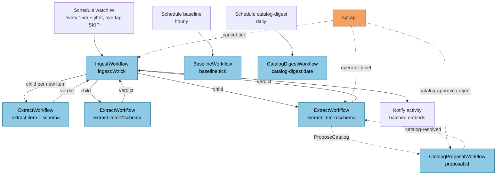
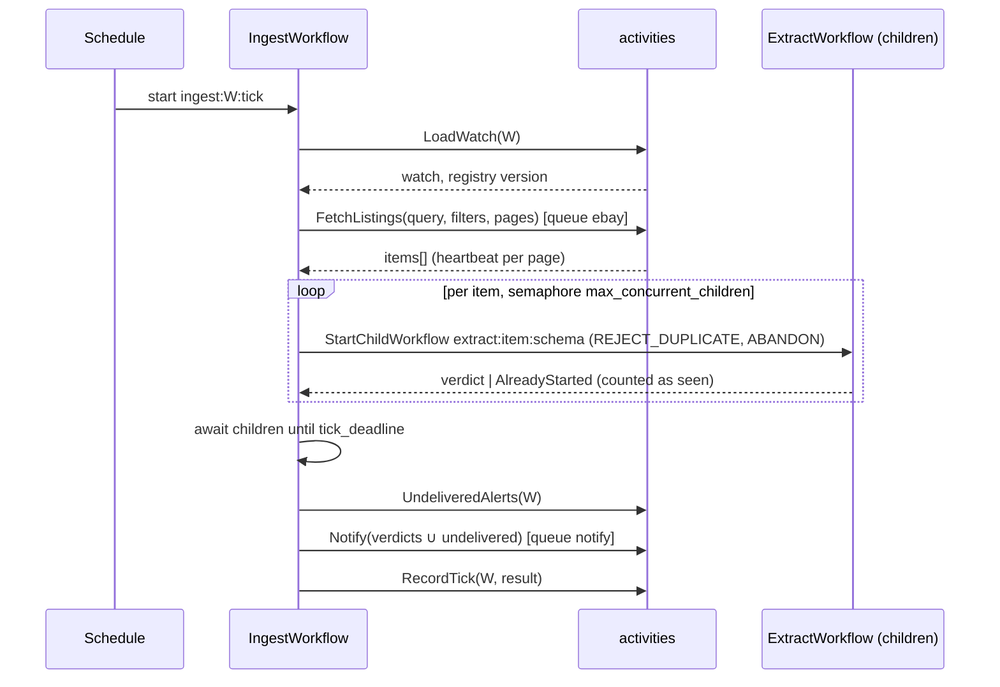
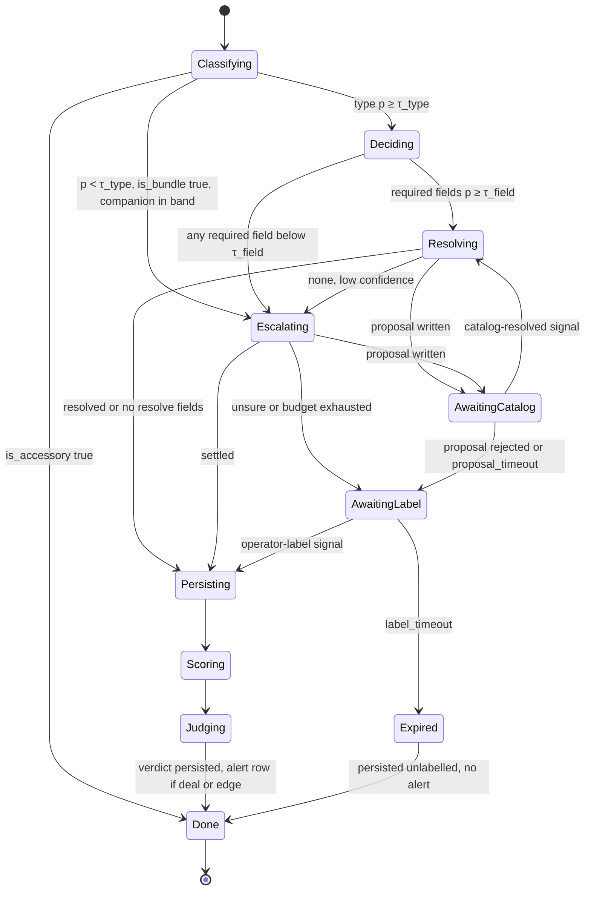

<!-- markdownlint-disable-file MD025 MD041 -->

# DESIGN-0002: Durable execution: workflows, activities, queues and signals

<!--toc:start-->
<!-- markdownlint-capture -->
<!-- markdownlint-disable MD013 -->
- [Overview](#overview)
- [Goals and Non-Goals](#goals-and-non-goals)
  - [Goals](#goals)
  - [Non-Goals](#non-goals)
- [Background](#background)
- [Detailed Design](#detailed-design)
  - [Workflow hierarchy](#workflow-hierarchy)
  - [IngestWorkflow](#ingestworkflow)
  - [ExtractWorkflow](#extractworkflow)
  - [BaselineWorkflow](#baselineworkflow)
  - [CatalogProposalWorkflow and CatalogDigestWorkflow](#catalogproposalworkflow-and-catalogdigestworkflow)
  - [Activities and the options table](#activities-and-the-options-table)
  - [Task queues](#task-queues)
  - [Signals](#signals)
  - [Search attributes](#search-attributes)
  - [Budgets and quota](#budgets-and-quota)
  - [IDs, deduplication and versioning](#ids-deduplication-and-versioning)
  - [Failure behaviour](#failure-behaviour)
  - [Observability](#observability)
  - [Plumbing in internal/temporal](#plumbing-in-internaltemporal)
  - [Scale notes](#scale-notes)
- [API / Interface Changes](#api--interface-changes)
- [Data Model](#data-model)
- [Testing Strategy](#testing-strategy)
- [Migration / Rollout Plan](#migration--rollout-plan)
- [Open Questions](#open-questions)
- [References](#references)
<!-- markdownlint-restore -->
<!--toc:end-->

<!--docz:overview:start-->
## Overview

This document specifies the Temporal side of ADR-0002: the four workflow
types and their IDs, the activities and the single options table that
declares their timeouts and retries, the task queues that carry the eBay,
model and Discord limits, the signals through which humans and the API
enter the loop, budgets and quota, versioning and rollouts, failure
behaviour, and the `internal/temporal` plumbing shared with the other
services on the cluster. It does not describe what happens inside a
decision (DESIGN-0003), the registry (DESIGN-0004) or the catalog
(DESIGN-0005); it describes how those steps are sequenced, retried,
paced and observed.

<!--docz:overview:end-->

## Goals and Non-Goals

<!--docz:goals:start-->
### Goals

- A listing's journey from eBay to Discord is one readable workflow
  history, and "where is item X" is a visibility query.
- Every external call is an activity with a declared timeout, retry
  policy and non-retryable error set, in one table.
- Rate limits and concurrency caps are worker options on named task
  queues, never code in a client.
- A human decision is a signal that resumes a waiting workflow; the
  label and the resumed execution are one history.
- Rollouts never strand in-flight listings: deployment versioning plus
  `GetVersion` for sequence changes.
- Every workflow is replayable from a checked-in history in CI.

<!--docz:goals:end-->

<!--docz:non-goals:start-->
### Non-Goals

- Batching listings per workflow. One child per listing until roughly
  100k listings per day; the section on scale says what changes then.
- Temporal Updates or Nexus. Signals and queries cover the operator
  loop; Updates are noted where they would fit later.
- Cross-namespace or multi-cluster execution.

<!--docz:non-goals:end-->

<!--docz:background:start-->
## Background

ADR-0002 records why Temporal and why the boundary with Postgres sits
where it does. DESIGN-0001 gives the roles, configuration (`workflows`
and `queue` blocks, `TEMPORAL_*` environment) and the data model the
activities write to.

Facts this design depends on:

- Temporal Schedules support interval specs with jitter and an overlap
  policy; `SKIP` drops a tick whose predecessor is still running.
- Child workflows have their own ID and reuse policy; `REJECT_DUPLICATE`
  fails the start if any run with that ID exists, terminated or not, and
  `ParentClosePolicy: ABANDON` lets a child outlive its parent.
- Worker options include `TaskQueueActivitiesPerSecond` (a server-side
  limit shared by all workers on the queue) and
  `MaxConcurrentActivityExecutionSize` (per worker).
- Signals are buffered and delivered in order; a `Selector` over a signal
  channel and a timer is the standard wait-with-timeout.
- Worker deployment versioning (SDK 1.49 and the cluster's server
  version) pins a workflow run to the build that started it unless the
  workflow opts into auto-upgrade; a new build is promoted explicitly.
- Search attributes are namespace-registered keys upserted by the
  workflow; visibility list queries filter on them.
- eBay Browse returns active listings only, enforces a per-second rate
  and a rolling 24-hour quota, and reports usage through the Analytics
  API. Discord webhooks accept ten embeds per POST and return bucket
  headers on 429.

repo-guardian and boop established on this cluster the client dial with
mTLS or OIDC, the server-version check, worker deployment versioning with
explicit build promotion, idempotent schedule and search-attribute
registration, SDK metrics through the OpenTelemetry contrib handler, a
cached Temporal CLI dev server for tests, name-only coupling between
workflows and activities, a central activity-options table, per-role
registration with a union for the replayer, and replay tests over
checked-in histories. Child workflows, task-queue rate limits, the
tracing interceptor and visibility queries from the api role are SDK
features neither service uses; they are used here as documented.

<!--docz:background:end-->

<!--docz:detailed-design:start-->
## Detailed Design

### Workflow hierarchy



| Workflow | ID | Started by | Lifetime |
| --- | --- | --- | --- |
| `IngestWorkflow` | `ingest:<watch-id>:<tick RFC3339>` | Schedule `watch:<watch-id>`; `POST /api/v1/ingest` | one tick, bounded by `tick_deadline` |
| `ExtractWorkflow` | `extract:<ebay-item-id>:<schema-version>` | `IngestWorkflow` as child | seconds, or up to `label_timeout` when waiting on an operator |
| `BaselineWorkflow` | `baseline:<tick RFC3339>` | Schedule `baseline`; `POST /api/v1/baselines/refresh` | minutes |
| `CatalogProposalWorkflow` | `proposal:<proposal-id>` | `ExtractWorkflow` via the `ProposeCatalog` activity (signal-with-start) | until approved, rejected or `proposal_timeout` |
| `CatalogDigestWorkflow` | `catalog-digest:<date>` | Schedule `catalog-digest` | seconds |

### IngestWorkflow

```go
type IngestInput struct {
    WatchID       string
    SchemaVersion string
    Full          bool   // ignore last_seen; re-extract everything the query returns
}

type IngestResult struct {
    Fetched, Started, Seen, Failed int
    Alerts                         int
    QuotaDeferred                  bool
}
```



Rules:

- `FetchListings` returns item summaries for the watch's query, with
  `last_seen` updated in the same activity so an item seen in a previous
  tick is skipped before any child is started, unless `Full`.
- Each new item starts a child under a workflow-local semaphore
  (`workflows.max_concurrent_children`). `WorkflowExecutionAlreadyStarted`
  is counted as `Seen` and swallowed; any other start error is `Failed`.
- Children are awaited with a `Selector` until `tick_deadline`. Children
  that have not completed by then (typically those in `AwaitingLabel`)
  are left running; their verdicts are picked up by a later tick through
  the `UndeliveredAlerts` query.
- Quota exhaustion from `FetchListings` (non-retryable
  `ErrTypeQuotaExhausted` carrying the reset time) makes the workflow
  sleep until the reset time plus one minute and retry the fetch once;
  on a second exhaustion the tick ends with `QuotaDeferred`.
- `cancel-tick` cancels the workflow context; children are abandoned,
  not cancelled, so a cancelled tick never loses a listing in flight.

### ExtractWorkflow

```go
type ExtractInput struct {
    Item          ebay.ItemSummary
    WatchID       string
    SchemaVersion string
}

type ExtractResult struct {
    Stage      string   // final stage name
    Verdict    string   // deal | edge | noise | ""
    VerdictP   float64
    Score      int
    AlertID    string   // set when an alert row was written
}
```



Each transition upserts the `SptStage` search attribute and the
`listings.stage` column (through the `SetStage` activity, which is cheap
and idempotent). The decision, resolve and escalate activities are
specified in DESIGN-0003 and DESIGN-0005; this workflow only sequences
them and branches on the probabilities they return against the
thresholds the registry declares (DESIGN-0004).

Waiting for a human:

```go
func awaitLabel(ctx workflow.Context, timeout time.Duration) (*LabelSignal, bool) {
    ch := workflow.GetSignalChannel(ctx, names.SignalOperatorLabel)
    var sig LabelSignal
    // Drain anything buffered before we started waiting.
    if ch.ReceiveAsync(&sig) {
        return &sig, true
    }
    timerCtx, cancel := workflow.WithCancel(ctx)
    defer cancel()
    sel := workflow.NewSelector(ctx)
    var got bool
    sel.AddReceive(ch, func(c workflow.ReceiveChannel, _ bool) { c.Receive(ctx, &sig); got = true })
    sel.AddFuture(workflow.NewTimer(timerCtx, timeout), func(workflow.Future) {})
    sel.Select(ctx)
    return &sig, got
}
```

After the signal the workflow runs `PersistLabel`, then continues to
`Persisting` with the operator's values in place of the model's, so the
label row and the resumed decision share one history.

### BaselineWorkflow

Hourly. Three activities in sequence: `MarkInactive` (items not seen in
two ticks of their watch get `active = false` and `ended_at`),
`RecomputeBaselines` (one transaction: upsert p25, p50, p75 and sample
count per product key over the trailing `scoring.window_days` of active
listings, then delete every baseline row whose key no active listing
carries), `EmitBaselineMetrics`. Overlap `SKIP`; a run longer than the
interval is a bug and an alert.

### CatalogProposalWorkflow and CatalogDigestWorkflow

One workflow per proposal, started with signal-with-start by the
`ProposeCatalog` activity so a second listing proposing the same row
attaches to the existing wait instead of creating a duplicate. It waits
on `catalog-approve` (with the operator's edits) or `catalog-reject` for
up to `proposal_timeout`. On approve it runs `ApplyCatalogDecision` (insert
the row, mark the proposal, record who) and signals `catalog-resolved` to
every `ExtractWorkflow` recorded as waiting on it. On reject or timeout
it signals the same waiters with a rejection, which sends them to
`AwaitingLabel`. The daily digest workflow lists pending proposals and
posts one summary embed; it holds no state.

### Activities and the options table

Activities are structs holding their dependencies with a `Register`
method. Every option lives in `internal/workflows/options.go`, keyed by
activity name, and every workflow fetches its options from there:

| Activity | Queue | Start-to-close | Heartbeat | Retry (max, initial → cap) | Non-retryable | Idempotency |
| --- | --- | --- | --- | --- | --- | --- |
| `LoadWatch` | `default` | 10s | — | 3, 1s → 10s | — | read-only |
| `FetchListings` | `ebay` | 5m | 30s | 5, 2s → 60s | `ErrTypeQuotaExhausted`, `ErrTypeAuth` | read + `last_seen` upsert |
| `Classify`, `Fields`, `Choose`, `Verdict` | `decide` | 30s | — | 3, 1s → 10s | `ErrTypeSchema`, `ErrTypeBudget`, `ErrTypeRefusal` | pure |
| `RetrieveCandidates` | `default` | 5s | — | 3, 1s → 5s | — | read-only |
| `Escalate` | `escalate` | 2m | 30s | 2, 5s → 30s | `ErrTypeBudget`, `ErrTypeRefusal`, `ErrTypeSchema` | pure; spend recorded with the result |
| `ProposeCatalog` | `default` | 10s | — | unlimited, 1s → 60s | — | signal-with-start by proposal key |
| `ApplyCatalogDecision` | `default` | 10s | — | unlimited, 1s → 60s | — | upsert by proposal ID |
| `Persist`, `PersistLabel`, `SetStage`, `RecordTick` | `default` | 10s | — | unlimited, 1s → 60s | — | upsert by item ID and schema version |
| `Score` | `default` | 5s | — | 3 | — | pure |
| `UndeliveredAlerts` | `default` | 10s | — | 3 | — | read-only |
| `Notify` | `notify` | 60s | — | 5, `NextRetryDelay` from bucket headers, cap 5m | `ErrTypeGlobal429`, `ErrTypeWebhookGone` | `alerts.delivered_at` set per alert inside the batch |
| `MarkInactive`, `RecomputeBaselines`, `EmitBaselineMetrics` | `default` | 5m | 30s | 2, 10s → 60s | — | single transaction |

Rules:

- Error types are string constants; activities return them with
  `temporal.NewApplicationErrorWithOptions(msg, errType,
  temporal.ApplicationErrorOptions{NonRetryable: true})`. Expected
  throttles (quota, budget) are errors because the workflow must branch;
  routine outcomes (an item already seen, a 'none of these' from the chooser) are
  results.
- Store activities treat an unreachable Postgres as retryable with an
  unlimited count and a capped backoff: the workflow holds, nothing is
  lost.
- Every activity that loops over pages or model calls heartbeats with
  its progress so a stuck worker is detected within the heartbeat
  timeout and the retry resumes from the recorded offset.
- Activity inputs and outputs are small structs; nothing larger than a
  few KB crosses the history. Listing specifics are passed once in
  `ExtractInput` and reloaded from the store by later activities that
  need them.

### Task queues

| Queue | Worker option | Default | Expresses |
| --- | --- | --- | --- |
| `ebay` | `TaskQueueActivitiesPerSecond` | 2 | eBay's per-second limit, as a server-side limit shared by all workers |
| `decide` | `MaxConcurrentActivityExecutionSize` | 16 | in-flight model spend |
| `escalate` | `MaxConcurrentActivityExecutionSize` | 4 | the expensive path |
| `notify` | `TaskQueueActivitiesPerSecond` | 1 | Discord webhook pacing |
| `default` | `MaxConcurrentActivityExecutionSize` | 32 | store and pure activities |

Workflow tasks are polled on `default` only. Queue names are
`<TEMPORAL_TASK_QUEUE_PREFIX>-<queue>`. One worker process polls every
queue by default; the `queue` blocks in `spt.hcl` set the options; a
deployment split per queue group is a chart values change
(`worker.queues`) with no code change.

### Signals

| Signal | Target | Payload | Sent by |
| --- | --- | --- | --- |
| `operator-label` | `ExtractWorkflow` | `{component_type, fields, catalog_ref, note, by}` | `POST /api/v1/listings/{id}/label` |
| `catalog-approve` | `CatalogProposalWorkflow` | `{edits, by}` | `POST /api/v1/catalog/proposals/{id}/approve` |
| `catalog-reject` | `CatalogProposalWorkflow` | `{reason, by}` | `POST /api/v1/catalog/proposals/{id}/reject` |
| `catalog-resolved` | `ExtractWorkflow` | `{proposal_id, catalog_ref, rejected bool}` | `CatalogProposalWorkflow` |
| `cancel-tick` | `IngestWorkflow` | — | `DELETE /api/v1/ingest/{workflow_id}` (`spt ingest cancel`) |

Queries (read-only, served by the worker from workflow state):
`stage` on `ExtractWorkflow` (current stage and the last decision
summary), `progress` on `IngestWorkflow` (fetched, started, done).

A signal to a workflow that has already completed returns `NotFound`
from the API; the handler then writes the `labels` row directly, which
counts for calibration and resumes nothing (DESIGN-0006).

### Search attributes

Registered at worker start, added only if missing:

| Key | Type | Set on |
| --- | --- | --- |
| `SptStage` | keyword | `ExtractWorkflow`, every transition |
| `SptWatch` | keyword | `IngestWorkflow`, `ExtractWorkflow` |
| `SptType` | keyword | `ExtractWorkflow` after classification |
| `SptSchemaVersion` | keyword | `ExtractWorkflow` |
| `SptComponentKey` | keyword | `ExtractWorkflow` after key rendering |

The runs endpoint (DESIGN-0006) lists by these; the Temporal UI filters
by them.

### Budgets and quota

| Budget | Stored as | Checked by | On exhaustion |
| --- | --- | --- | --- |
| eBay rolling 24h quota | `quota_usage` row per day, synced from the Analytics API at the start of each tick | `FetchListings` before each page | `ErrTypeQuotaExhausted` with reset time; parent sleeps to reset |
| Decide spend per day | `budgets('decide', day)` | decide activities before the call | `ErrTypeBudget`; listing goes to `AwaitingLabel` |
| Escalate spend per day | `budgets('escalate', day)` | `Escalate` before the call | `ErrTypeBudget`; listing goes to `AwaitingLabel` |

Spend is computed from the model's reported usage and the configured
price table, and written by `Persist` in the same transaction as the
decision rows, so a retried activity cannot double-count. A manual
ingest reserves `ebay.quota_reserve` of the daily quota so an operator
can always run one.

### IDs, deduplication and versioning

- `extract:<item>:<schema>` with `REJECT_DUPLICATE`: the same item is
  never extracted twice under one registry version; a new registry
  version is new work and the store keeps both decision sets.
- `ingest:<watch>:<tick>` with overlap `SKIP` on the Schedule: a tick
  never overlaps its predecessor.
- `proposal:<id>` with signal-with-start: duplicate proposals attach to
  one wait.
- Sequence changes inside a workflow use `workflow.GetVersion` with a
  change ID named after the DESIGN or IMPL that introduced it; activity
  signatures are additive (new optional fields, never renamed or
  removed).
- Worker deployment versioning: the build ID is the image tag; workers
  start pinned, `PromoteBuild` makes the newest semver current after
  the worker is ready, old builds drain. `ExtractWorkflow` and
  `IngestWorkflow` use pinned behaviour (a run finishes on the build
  that started it); `BaselineWorkflow` and `CatalogDigestWorkflow` use
  auto-upgrade because they hold no sequence state worth pinning.

### Failure behaviour

| Failure | Behaviour |
| --- | --- |
| Jev down or slow | cascade falls through to Claude; `spt_decide_fallback_total` |
| Jev and Claude down | decide activities exhaust retries; workflow retries the stage with backoff up to 24h, then `AwaitingLabel` |
| Decide budget exhausted | listing goes to `AwaitingLabel`; the budget gauge alerts |
| eBay 5xx or timeout | activity retries; the tick fails after five; the Schedule's next tick is unaffected |
| eBay quota exhausted | tick sleeps to reset once, then `QuotaDeferred` |
| Postgres unreachable | store activities retry without limit; every workflow holds; nothing is lost |
| Worker crash mid-listing | replay from history; idempotent persist absorbs re-runs |
| Discord 429 (bucket) | `NextRetryDelay` from headers; delivered flags set per alert so a partial batch is not resent |
| Discord global 429 or webhook deleted | non-retryable; alerts stay undelivered; next tick retries; alert fires |
| Operator never labels | `label_timeout`; persisted unlabelled, no alert, excluded from baselines |
| Proposal never reviewed | `proposal_timeout`; waiters go to `AwaitingLabel` |
| Registry fails validation on a new build | worker refuses to start; the build is never promoted; the previous build keeps serving |
| Temporal unreachable | api returns 503 on start and signal endpoints with a problem document; worker reconnects; readiness drops |

### Observability

- Traces: the SDK's tracing interceptor on client and worker produces a
  span per workflow task and activity; activities add child spans for
  outbound calls. The Langfuse trace for a listing has `sessionId` equal
  to the `ExtractWorkflow` ID and carries the run ID as metadata.
- Metrics: SDK metrics (poll latency, task latency, schedule-to-start,
  activity failures by type) through the contrib handler; the app
  metrics in DESIGN-0001 from activities through a `Metrics` interface
  and from workflows through `workflow.GetMetricsHandler`.
- Logs: the SDK slog adapter adds workflow type, ID and run ID;
  activities log at `warn` on retryable failure and `error` only on
  non-retryable.
- `DescribeBacklog` per queue feeds `GET /api/v1/status` and the
  backlog alert.

### Plumbing in `internal/temporal`

| Piece | Behaviour |
| --- | --- |
| `ConfigFromEnv` | reads the `TEMPORAL_*` variables; validates that exactly one of mTLS or OIDC is configured when TLS is on |
| `Dial` | `client.Dial` with TLS, the OIDC client-credentials `HeadersProvider` that caches and refreshes the bearer, the slog adapter, the metrics handler and the tracing interceptor; then `CheckServerVersion` against the minimum |
| `NewWorker` | per-queue options from the `queue` blocks, `WorkerStopTimeout`, deployment versioning with the build ID, `EnableSessionWorker: false`, the sysinfo identity `<POD_NAME>@<build>` |
| `PromoteBuild` | compares the current deployment version with the worker's; sets current when newer by semver; compare-and-set on the conflict token |
| `RequireCurrentVersion` | readiness check: the worker's build is current or being ramped |
| `EnsureSchedule`, `RemoveSchedule` | create-or-update with interval, jitter, overlap `SKIP`, catch-up window, paused flag; idempotent |
| `EnsureSearchAttributes` | adds missing keys through the operator service |
| `DescribeBacklog` | `DescribeTaskQueueEnhanced` per queue |
| `temporaltest.Start(t)` | starts the Temporal CLI dev server once per test binary with an in-memory SQLite database and a fresh namespace per test |
| `recorder` | env-gated: when `SPT_RECORD_HISTORIES=1`, integration tests export each completed workflow's history to `testdata/histories/<type>/<name>.json` |

### Scale notes

At the expected volume (tens of watches, tens of thousands of listings
per day at peak) histories stay under a few hundred events and the
default visibility store suffices. Past roughly 100k listings per day:
batch items into one `ExtractBatchWorkflow` per 50 with `ContinueAsNew`,
move the `decide` queue to its own worker Deployment, and consider
advanced visibility. None of these change the activities.

<!--docz:detailed-design:end-->

<!--docz:api-changes:start-->
## API / Interface Changes

- Configuration: the `workflows` and `queue` blocks and the `TEMPORAL_*`
  environment (DESIGN-0001).
- CLI: `spt ingest [--watch] [--full] [--schema-version]`, `spt ingest
  cancel <workflow-id>`, `spt runs list | journal`.
- API: `POST /api/v1/ingest`, `DELETE /api/v1/ingest/{workflow_id}`,
  `POST /api/v1/baselines/refresh`,
  `GET /api/v1/runs`, `GET /api/v1/runs/{id}/journal`, the signal-sending
  endpoints for labels and proposals, and the backlog section of
  `GET /api/v1/status` (DESIGN-0006).
- Chart: `worker.replicas`, `worker.stopTimeout`, `worker.queues` (a
  list of queue groups per Deployment, default one group with all),
  `temporal.*` values.
- Go: `internal/workflows/names` is the only package the api role may
  import from the workflow tree.

<!--docz:api-changes:end-->

<!--docz:data-model:start-->
## Data Model

No tables of its own. This design writes `listings.stage`,
`listings.last_seen`, `listings.active`, `decisions`, `labels`,
`alerts.delivered_at`, `price_baselines`, `catalog_proposals.status`,
`quota_usage` and `budgets` through the activities above; the schema is
in DESIGN-0001. Workflow histories and search attributes live in
Temporal's own store and are not a source for anything the UI or a
report needs except the runs view, which reads visibility and history by
design.

<!--docz:data-model:end-->

<!--docz:testing:start-->
## Testing Strategy

- **Workflow unit tests** under `testsuite.WorkflowTestSuite` with
  activities registered by name and faked: every branch of the
  `ExtractWorkflow` state machine, the semaphore and deadline behaviour
  of `IngestWorkflow`, `REJECT_DUPLICATE` handling, quota sleep, signal
  before and after the wait begins, timeout expiry, `GetVersion`
  branches.
- **Activity unit tests** under `TestActivityEnvironment` with mockery v3
  mocks of the decider, eBay client, store and notifier: error-type
  mapping, heartbeat progress, idempotent upserts, budget checks.
- **Options table test**: every registered activity has an entry; every
  entry names a registered activity; no activity on a rate-limited queue
  lacks a heartbeat when its timeout exceeds one minute.
- **Replay tests** over `testdata/histories` with the union
  registration, run in `just test`; the recorder refreshes histories
  during integration runs; a history is added for every release that
  introduces a `GetVersion` change.
- **Integration** (`just test-integration`): `temporaltest.Start(t)` and
  testcontainers Postgres; a full tick against the mock eBay server with
  scenario files for pagination, 429, 5xx and quota exhaustion; signals
  sent through the real client; schedule creation and overlap.
- **Versioning**: an integration test that starts a long
  `ExtractWorkflow` on build A, promotes build B, and asserts the run
  finishes on A while a new run starts on B.

<!--docz:testing:end-->

<!--docz:rollout:start-->
## Migration / Rollout Plan

1. `internal/temporal` with the dev server test harness; `IngestWorkflow`
   and `ExtractWorkflow` with mock activities; replay histories recorded
   (RFC-0001 phase 3).
2. Real activities behind the mocks one group at a time: store, eBay
   against the mock server, decide against fixtures, notify against a
   capture endpoint.
3. Dev namespace on the cluster; one watch; quota capped; Discord to a
   test channel.
4. All watches in `spt-dev` for a labelled two-week soak; then the prod
   namespace (IMPL-0004).

<!--docz:rollout:end-->

<!--docz:open-questions:start-->
## Open Questions

All questions below were decided on 2026-11-06; the chosen option is
recorded and the alternatives are dropped. The body of the design
reflects the decision.

**Q1. Late children at the tick deadline.** Decided (2026-11-06): option a.
The parent abandons children still waiting (on an operator or a proposal) and the next tick delivers their alerts through the `UndeliveredAlerts` query. The tick is bounded; a label days later still produces an alert.

**Q2. One workflow per catalog proposal, or one daily review workflow?** Decided (2026-11-06): option a.
One `CatalogProposalWorkflow` per proposal, signal-with-start, with a separate stateless daily digest. Signal targets are exact, waiters are re-resolved on approval, and duplicates collapse by ID.

**Q3. Labelling a listing whose workflow has completed or expired.** Decided (2026-11-06): option a.
The API writes the `labels` row directly when the signal returns `NotFound`; the label counts for calibration and resumes nothing. A later `spt ingest --full` re-extracts under the new registry version if the label changes the schema.

**Q4. eBay quota exhaustion mid-tick.** Decided (2026-11-06): option a.
Sleep until the reset time once, then end the tick as deferred.

**Q5. Undelivered-alert retry cadence.** Decided (2026-11-06): option a.
The next tick of the same watch retries delivery (15 minutes).

**Q6. Workflow-task queue.** Decided (2026-11-06): option a.
Workflow tasks on `default` only; activity queues carry activities only.

<!--docz:open-questions:end-->

<!--docz:references:start-->
## References

- [RFC-0001 spt: durable execution of typed decisions over watched eBay listings](../rfc/0001-spt-durable-execution-of-typed-decisions-over-watched-ebay.md)
- [ADR-0002 Temporal is the execution plane; Postgres is the system of record](../adr/0002-temporal-is-the-execution-plane-postgres-is-the-system-of-record.md)
- [DESIGN-0001 System architecture](../design/0001-system-architecture-roles-configuration-deployment-and-data.md); [DESIGN-0003 Decisions](../design/0003-decisions-the-decider-contract-cascade-escalation-and.md); [DESIGN-0005 Catalog](../design/0005-catalog-canonical-identities-retrieval-and-proposals.md); [DESIGN-0006 API](../design/0006-api-the-openapi-contract-authentication-and-clients.md)
- [repo-guardian `internal/temporal`](https://github.com/donaldgifford/repo-guardian/tree/main/internal/temporal) and [`internal/workflows`](https://github.com/donaldgifford/repo-guardian/tree/main/internal/workflows); [DESIGN-0026](https://github.com/donaldgifford/repo-guardian/blob/main/docs/design/0026-v2-temporal-control-plane-and-role-split.md); [DESIGN-0032 Evaluation and remediation workflows](https://github.com/donaldgifford/repo-guardian/blob/main/docs/design/0032-evaluation-and-remediation-workflows-change-driven-remediation.md)
- [boop `internal/worker/worker.go`](https://github.com/donaldgifford/boop/blob/main/internal/worker/worker.go); [boop DESIGN-0001 boopd spike](https://github.com/donaldgifford/boop/blob/main/docs/design/0001-boopd-spike-workflows-runrenovate-activity-and-worker.md); [boop ADR-0002 One entity workflow per repository](https://github.com/donaldgifford/boop/blob/main/docs/adr/0002-one-entity-workflow-per-repository.md)
- [server-price-tracker `internal/ebay`](https://github.com/donaldgifford/server-price-tracker/tree/main/internal/ebay); [`internal/notify`](https://github.com/donaldgifford/server-price-tracker/tree/main/internal/notify); [DESIGN-0009 Discord notifier rate limiting and embed chunking](https://github.com/donaldgifford/server-price-tracker/blob/main/docs/design/0009-discord-notifier-rate-limiting-and-embed-chunking.md); [DESIGN-0004 Inactive listings lifecycle](https://github.com/donaldgifford/server-price-tracker/blob/main/docs/design/0004-inactive-listings-lifecycle.md)
- [Temporal Go SDK: child workflows](https://docs.temporal.io/develop/go/child-workflows); [schedules](https://docs.temporal.io/develop/go/schedules); [worker versioning](https://docs.temporal.io/worker-versioning); [message passing](https://docs.temporal.io/develop/go/message-passing); [`worker.Options`](https://pkg.go.dev/go.temporal.io/sdk/worker#Options)
- [eBay Browse API](https://developer.ebay.com/api-docs/buy/browse/overview.html); [eBay Analytics API rate limits](https://developer.ebay.com/api-docs/developer/analytics/resources/rate_limit/methods/getRateLimits); [Discord webhook rate limits](https://discord.com/developers/docs/topics/rate-limits)

<!--docz:references:end-->
