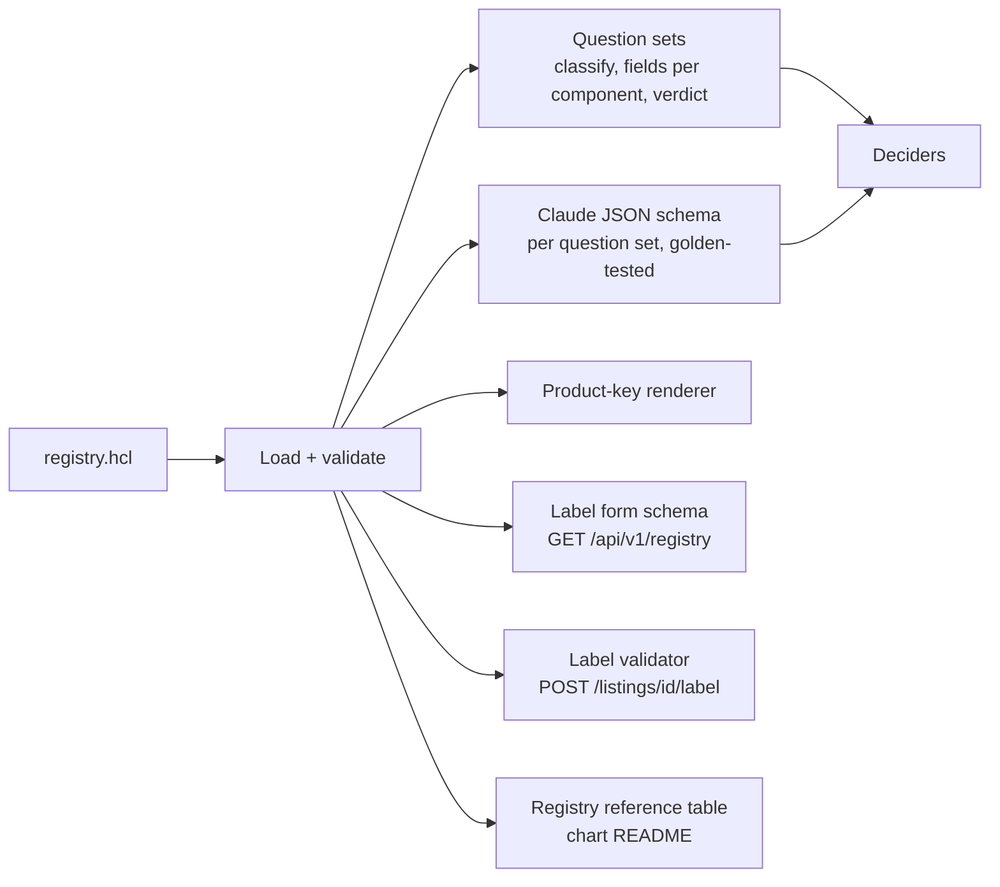

<!-- markdownlint-disable-file MD025 MD041 -->

# DESIGN-0004: Registry: the domain schema as an embedded HCL file

<!--toc:start-->
<!-- markdownlint-capture -->
<!-- markdownlint-disable MD013 -->
- [Overview](#overview)
- [Goals and Non-Goals](#goals-and-non-goals)
  - [Goals](#goals)
  - [Non-Goals](#non-goals)
- [Background](#background)
- [Detailed Design](#detailed-design)
  - [Grammar](#grammar)
  - [Example](#example)
  - [Loading and validation](#loading-and-validation)
  - [Schema version](#schema-version)
  - [What is derived from the registry](#what-is-derived-from-the-registry)
  - [How a registry change ships](#how-a-registry-change-ships)
- [API / Interface Changes](#api--interface-changes)
- [Data Model](#data-model)
- [Testing Strategy](#testing-strategy)
- [Migration / Rollout Plan](#migration--rollout-plan)
- [Open Questions](#open-questions)
- [References](#references)
<!-- markdownlint-restore -->
<!--toc:end-->

<!--docz:overview:start-->
## Overview

This document specifies `pkg/registry`: the HCL grammar that declares
component types, their questions, options and criteria, thresholds,
product-key templates, derived fields and resolve rules; how the file is
embedded, loaded, validated and hashed into `schema_version`; how the
question sets, the Claude schema and the label form are derived from it;
and how a registry change ships. ADR-0003 records why the schema is data
and why it is embedded.

<!--docz:overview:end-->

## Goals and Non-Goals

<!--docz:goals:start-->
### Goals

- Adding a component type, an option or a criterion is one file change.
- Every decision, listing and workflow carries a `schema_version` that is
  reproducible from the file.
- The registry is the single source for the decider question sets, the
  Claude JSON schema, the product-key renderer, the label form in the UI
  and the registry page in the API.
- A bad registry fails at load with positioned diagnostics, never at the
  first tick.
- A registry change is reviewed as a diff with regression numbers
  attached.

<!--docz:goals:end-->

<!--docz:non-goals:start-->
### Non-Goals

- Editing the registry at runtime or per deployment.
- Encoding prices, baselines or catalog rows. The registry declares
  shapes; the catalog holds instances (DESIGN-0005).
- A general schema language. The grammar has exactly the blocks the
  pipeline needs.

<!--docz:non-goals:end-->

<!--docz:background:start-->
## Background

ADR-0001 fixes the three question kinds and the contract they feed.
ADR-0003 chooses an embedded HCL file hashed into a version. ADR-0005
chooses hclkit as the decoder, which gives labelled nested blocks, typed
attributes through cty, validators with source positions, and the
`hclkit fmt` and `hclkit validate` commands.

The first implementation's schema was Go: a `ComponentType` enum, a
struct per type under `pkg/types`, a prompt per type, a `CHECK`
constraint on `component_type`, a scorer switch, a UI switch, and the
CLI's validation. Its `CLAUDE.md` lists eight touchpoints per type. The
registry replaces all eight with one block.

<!--docz:background:end-->

<!--docz:detailed-design:start-->
## Detailed Design

### Grammar

| Block | Labels | Attributes | Nested |
| --- | --- | --- | --- |
| `registry` | — | `version_note` (free text, not hashed into behaviour but hashed into the file) | — |
| `classify` | — | `question`, `threshold` | `bool` (exactly `is_accessory` and `is_bundle`, the companions asked in the same call) |
| `component` | `"<key>"` | `display`, `key` (template), `required` (list), `threshold`, `baseline` (bool, default true) | `choice`, `bool`, `score`, `derived`, `resolve` |
| `choice` | `"<name>"` | `question`, `options` (ordered map key → criteria), `threshold`, `optional` (bool) | — |
| `bool` | `"<name>"` | `question`, `true`, `false`, `threshold`, `optional` | — |
| `score` | `"<name>"` | `question`, `levels` (ordered list of 1–10 level descriptions; the answer is the level index from 0), `threshold`, `optional` | — |
| `derived` | `"<name>"` | `from` (list of question or derived names), `map` (joined input values → output), `default` | — |
| `resolve` | `"<name>"` | `source` (list of `specifics:<Name>` entries), `catalog` (bool), `optional` | — |
| `verdict` | — | — | `bool` (exactly `is_lot_or_multiple`, `is_part_or_accessory`, `title_contradicts_key`, `scam_pattern`, `baseline_applies`; combined by `decide.AlertGate`, DESIGN-0003) |

Option keys are what the pipeline stores and renders; criteria are what
the model reads. `options` is an ordered map (hclkit preserves source
order) so the compiled schema and the Jev request are stable. A `choice`
never carries a "none" or "other" option; the case where nothing fits is
its own `bool` in the same block: a `bool` named `<choice>_listed` is
the companion of the `choice` of that name, and `classify` and `verdict`
hold only the fixed companions and judgments listed above.

### Example

```hcl
registry {
  version_note = "ram, drive, server, cpu, gpu for the first release"
}

classify {
  question  = "What single kind of item is this listing selling?"
  threshold = 0.85

  bool "is_accessory" {
    question = "Is the listing selling only an accessory for one of these kinds, not the item itself?"
    true     = "caddies, trays, rails, bezels, cables, backplanes, risers, heatsinks, fans, PSUs sold alone"
    false    = "the item itself is for sale, with or without accessories included"
  }

  bool "is_bundle" {
    question = "Does the price cover several distinct products?"
    true     = "'lot of' mixed items, a server plus separate drives, multiple chassis models priced together"
    false    = "one product, or several identical units of one product"
  }
}

component "ram" {
  display   = "Memory"
  key       = "ram:{generation}:{ecc_reg}:{capacity_gb}gb:{speed_mhz}"
  required  = ["generation", "capacity_gb", "ecc", "registered"]
  threshold = 0.80

  choice "generation" {
    question = "Which DDR generation is this memory?"
    options = {
      ddr3 = "DDR3, PC3, PC3L"
      ddr4 = "DDR4, PC4"
      ddr5 = "DDR5, PC5"
    }
  }

  choice "capacity_gb" {
    question = "Capacity per module in GB (not the total for a kit or lot)."
    options = {
      "4" = "4GB per module", "8" = "8GB", "16" = "16GB", "32" = "32GB",
      "64" = "64GB", "128" = "128GB", "256" = "256GB"
    }
  }

  bool "capacity_gb_listed" {
    question = "Is the capacity per module one of 4, 8, 16, 32, 64, 128 or 256 GB?"
    true     = "the listing states one of those sizes per module"
    false    = "a different size, or the size per module is not stated"
  }

  choice "speed_mhz" {
    question = "Rated transfer rate in MT/s. PC4-21300 is 2666; PC4-25600 is 3200; PC3-12800 is 1600."
    options = {
      "1333" = "", "1600" = "", "1866" = "", "2133" = "", "2400" = "", "2666" = "",
      "2933" = "", "3200" = "", "4800" = "", "5600" = ""
    }
    optional = true
  }

  bool "speed_mhz_listed" {
    question = "Is the rated transfer rate one of the listed MT/s values?"
    true     = "the listing states one of them, directly or as a PC3/PC4 code"
    false    = "a different rate, or no rate is stated"
    optional = true
  }

  bool "ecc" {
    question = "Is this ECC memory?"
    true     = "ECC, RDIMM, LRDIMM, registered, buffered, server memory"
    false    = "non-ECC, desktop or laptop memory, UDIMM without ECC, SODIMM"
  }

  bool "registered" {
    question = "Is this registered or buffered (RDIMM or LRDIMM)?"
    true     = "RDIMM, LRDIMM, registered, buffered"
    false    = "UDIMM, unbuffered, SODIMM, ECC UDIMM"
  }

  choice "quantity" {
    question  = "How many modules does the buyer receive for the price?"
    options   = { "1" = "a single module", "2" = "a pair or kit of 2", "4" = "kit of 4", "8" = "kit of 8", lot = "a lot or an unspecified multiple" }
    threshold = 0.70
  }

  score "listing_quality" {
    question = "How complete and specific is this listing about what is being sold?"
    levels = [
      "title only, no specifics",
      "some specifics filled, no part number",
      "part number or full spec in title or specifics",
      "part number, speed, rank, voltage and photos of the label",
    ]
    optional = true
  }

  derived "ecc_reg" {
    from = ["ecc", "registered"]
    map  = { "true,true" = "ecc_reg", "true,false" = "ecc_udimm", "false,false" = "non_ecc", "false,true" = "non_ecc" }
  }

  resolve "part_number" {
    source   = ["specifics:MPN", "specifics:Manufacturer Part Number", "specifics:Model"]
    catalog  = false
    optional = true
  }
}

component "server" {
  display   = "Server"
  key       = "server:{catalog.vendor}:{catalog.model}:{drive_ff}:{tier}"
  required  = ["model", "drive_ff", "tier"]
  threshold = 0.80

  resolve "model" {
    source  = ["specifics:Model", "specifics:MPN"]
    catalog = true
  }

  choice "drive_ff" {
    question = "Which drive bay form factor does the chassis have?"
    options  = { sff = "2.5 inch bays, SFF", lff = "3.5 inch bays, LFF", nvme = "U.2 or NVMe bays", mixed = "both sizes", none = "no bays or diskless" }
  }

  choice "tier" {
    question = "How much of a working server is included?"
    options = {
      barebone   = "chassis only, or chassis with motherboard but no CPUs or memory"
      partial    = "some of CPUs, memory, drives, controllers or PSUs, not all"
      configured = "CPUs, memory and at least one PSU present; usable as delivered"
    }
  }

  bool "rails_included" { question = "Are rails included?" true = "rails, rail kit, sliding rails included" false = "no rails, rails not included, not mentioned" optional = true }
  bool "drives_included" { question = "Are drives included?" true = "drives, SSDs, HDDs included" false = "no drives, caddies only, not mentioned" optional = true }

  choice "quantity" {
    question = "How many servers does the buyer receive?"
    options  = { "1" = "one", "2" = "two", lot = "more or unspecified" }
    threshold = 0.70
  }
}

verdict {
  bool "is_lot_or_multiple" {
    question = "Does the price cover more units than the quantity says?"
    true     = "'lot of', 'x10', 'pallet', several units in the photos with one price"
    false    = "the stated quantity is what the price buys"
  }

  bool "is_part_or_accessory" {
    question = "Is this a part or accessory of the keyed item rather than the item?"
    true     = "a caddy, rail kit, bezel, cable, heatsink, riser or fan for it"
    false    = "the keyed item itself"
  }

  bool "title_contradicts_key" {
    question = "Does the title name a different generation, capacity or model than the key?"
    true     = "the title says DDR3 where the key says ddr4, 16GB where it says 32gb, R720 where it says r730"
    false    = "the title agrees with the key or does not state those details"
  }

  bool "scam_pattern" {
    question = "Does the listing show a scam pattern?"
    true     = "stock photos with a price far under the baseline p25, a seller with no history and many such listings, 'message me for price'"
    false    = "own photos, a price near the baseline, an established seller"
  }

  bool "baseline_applies" {
    question = "Is this listing the same kind of thing as the baseline's other listings?"
    true     = "same generation, capacity and condition class as the key; sold the same way"
    false    = "a different condition class, a refurbished unit against a used baseline, a kit against single modules"
  }
}
```

### Loading and validation

```go
package registry

//go:embed registry.hcl
var source []byte

type Registry struct {
    SchemaVersion string
    Classify      QuestionSet
    Verdict       QuestionSet
    Components    map[string]Component   // ordered keys available via Keys()
}

func Load() (*Registry, hclkit.Diagnostics)          // embedded file
func LoadFile(path string) (*Registry, hclkit.Diagnostics)  // for spt decide --registry and spt registry validate
```

Validators, all run and reported together with positions:

| Rule | Error |
| --- | --- |
| component keys unique, `[a-z][a-z0-9_]*` | duplicate or invalid key |
| every name in `required` is a declared question, derived or resolve | unknown required field |
| every `{placeholder}` in `key` is a declared question, derived, resolve, or `catalog.<attr>` | unknown placeholder |
| a `catalog.*` placeholder requires at least one `resolve` with `catalog = true` | key needs catalog but nothing resolves |
| `choice.options` non-empty, ≤255, keys unique, keys `[a-z0-9_.-]+` | option set invalid |
| `bool` has both `true` and `false` criteria | missing criteria |
| `score.levels` has 1 to 10 entries, each a non-empty situation | levels invalid |
| `derived.map` is total over the product of its inputs' option sets, or has `default` | derived map incomplete |
| `derived.from` references only `choice` or `bool` questions | derived from unsupported kind |
| `resolve.source` entries are `specifics:<Name>` | invalid source |
| thresholds in (0, 1] | threshold out of range |
| `classify` holds exactly the bools `is_accessory` and `is_bundle` | classify companions invalid |
| `verdict` holds exactly the five judgment bools named in the grammar | verdict judgments invalid |
| no `choice` option key is `other`, `none`, `unknown` or `n/a` | choice has a none option; declare a companion bool |
| a `bool` named `<x>_listed` has a `choice` named `<x>` in the same component, and matches its `optional` | listed companion without its choice |
| no question named `quantity` missing on a component with `baseline = true` | quantity required for baseline types |

### Schema version

`schema_version` is the first 12 hex characters of SHA-256 over the
canonical form of the file: the embedded bytes passed through hclkit's
formatter so whitespace-only edits do not bump the version. It is computed once at load and exposed by
`Registry.SchemaVersion`, `spt registry version`,
`GET /api/v1/registry`, every `ExtractWorkflow` ID and the
`SptSchemaVersion` search attribute.

### What is derived from the registry



- **Question sets** (`Registry.Classify`, `Component.Fields()`,
  `Registry.Verdict`, and `Component.Choose(candidates)` which builds the
  catalog chooser at runtime): the `decide.QuestionSet` the activities
  pass to the cascade. Thresholds ride along per question.
- **Product keys**: `Component.RenderKey(answers, derived, catalogRow)`
  fills the template. A placeholder whose value is `null` (an optional
  question below threshold, or one whose `_listed` companion is not
  true) renders as `unknown`, and a key
  with `unknown` in a required position is not written; the listing is
  escalated instead.
- **Label form**: `GET /api/v1/registry` returns the components, their
  questions, option keys and display criteria, so the UI generates one
  control per question (DESIGN-0007).
- **Label validation**: `POST /api/v1/listings/{id}/label` rejects a
  label whose values are not declared options for that component and
  registry version.
- **Reference table**: `tools/registry-docs` renders a markdown table
  per component into the chart README section, kept current by the
  docs check.

### How a registry change ships

1. Edit `pkg/registry/registry.hcl`; `hclkit fmt`; `spt registry
   validate`.
2. Try it locally: `spt decide --registry registry.hcl <item-id>` prints
   the answers and probabilities for one listing without the store.
3. `just test-regression` runs the golden dataset through each decider
   with the edited registry; paste the accuracy and calibration tables
   into the PR.
4. `spt registry diff main` in CI prints which components, questions and
   options changed; the PR template requires it. Removing an option or a
   component that the store references is allowed (old decision rows
   keep their `schema_version`), but the diff flags it.
5. Merge with a semver label; the release bumps `schema_version` by
   construction; new listings extract under the new version; `spt
   ingest --full --schema-version <new>` re-extracts existing ones when
   wanted.

<!--docz:detailed-design:end-->

<!--docz:api-changes:start-->
## API / Interface Changes

- `pkg/registry` public API: `Load`, `LoadFile`, `Registry`, `Component`,
  `RenderKey`, `Fields`, `Choose`, `Diff`.
- CLI: `spt registry validate [file]`, `spt registry diff <git-ref>`,
  `spt registry version`, `spt decide --registry <file>`.
- API: `GET /api/v1/registry` returning `{schema_version, components[],
  classify, verdict}` with questions, option keys and criteria.
- Chart README: a generated registry reference section.
- Database: no `CHECK` constraints on `component_type` or option
  columns; the registry validates.

<!--docz:api-changes:end-->

<!--docz:data-model:start-->
## Data Model

The registry is not stored. Its hash is: `listings.schema_version`,
`decisions.schema_version`, `labels.schema_version`, `alerts.schema_version`.
`listings.fields` holds accepted answers and derived values as JSON keyed
by question name, so a report can read them without re-deriving from
`decisions`.

<!--docz:data-model:end-->

<!--docz:testing:start-->
## Testing Strategy

- Table-driven validator tests: one invalid fixture per rule, asserting
  the diagnostic and its position.
- Golden tests: the embedded registry loads; its `schema_version` equals
  `spt registry version`; the compiled Claude schema per question set
  matches the committed golden file; the rendered reference table matches
  the chart README section.
- Key rendering: fixture answers per component produce the expected
  keys, including `unknown` handling and catalog placeholders.
- Derived maps: totality is tested per component.
- `spt registry diff`: fixture pairs produce the expected change list.
- Regression: the golden dataset through the embedded registry on every
  PR that touches `pkg/registry`.

<!--docz:testing:end-->

<!--docz:rollout:start-->
## Migration / Rollout Plan

1. Grammar, loader and validators with a two-component fixture registry
   (RFC-0001 phase 2).
2. Registry authored for the first-release component set (`ram`,
   `drive`, `server`, `cpu`, `gpu`), criteria checked against the golden
   dataset.
3. Remaining components added as separate PRs with their regression
   tables.
4. Thresholds revised from calibration after 30 days of labels.

<!--docz:rollout:end-->

<!--docz:open-questions:start-->
## Open Questions

All questions below were decided on 2026-11-06; the chosen option is
recorded and the alternatives are dropped. The body of the design
reflects the decision.

**Q1. Component set in the first release.** Decided (2026-11-06): option a.
`ram`, `drive`, `server`, `cpu`, `gpu`: the five with the most listing volume and the clearest keys. `nic`, `workstation` and `desktop` follow as separate PRs once the catalog has rows for them.

**Q2. What bytes does `schema_version` hash?** Decided (2026-11-06): option a.
The hclkit-formatted canonical form, so a whitespace or comment-only edit does not bump the version or trigger re-extraction.

**Q3. Thresholds per decider.** Decided (2026-11-06): option a.
One threshold per question regardless of which decider answered, until the calibration report can compare Jev and Claude on the same labels.

**Q4. `other` on a bounded numeric.** Decided (2026-11-06): option a;
refined by IMPL-0002 Q7 (2026-11-14). There is no `other` option; each
bounded numeric has a companion `bool` `<field>_listed`. When it is
false the field is `null` with the probability, counted in a metric,
never escalated for alone; a rising rate is the signal to add an option.

**Q5. Required-field policy for a missing `quantity`.** Decided (2026-11-06): option a.
`quantity` is required for every component with `baseline = true`, because per-unit price is what the baseline compares; below threshold it escalates.

<!--docz:open-questions:end-->

<!--docz:references:start-->
## References

- [RFC-0001 spt: durable execution of typed decisions over watched eBay listings](../rfc/0001-spt-durable-execution-of-typed-decisions-over-watched-ebay.md)
- [ADR-0001 Every finite question is a typed decision with a calibrated probability](../adr/0001-every-finite-question-is-a-typed-decision-with-a-calibrated.md)
- [ADR-0003 The domain schema is data: an HCL registry embedded in the binary](../adr/0003-the-domain-schema-is-data-an-hcl-registry-embedded-in-the-binary.md)
- [ADR-0005 Configuration is HCL decoded with hclkit](../adr/0005-configuration-is-hcl-decoded-with-hclkit.md)
- [DESIGN-0003 Decisions](../design/0003-decisions-the-decider-contract-cascade-escalation-and.md); [DESIGN-0005 Catalog](../design/0005-catalog-canonical-identities-retrieval-and-proposals.md); [DESIGN-0007 Operator UI](../design/0007-operator-ui-alerts-review-catalog-and-runs.md) (label form)
- [hclkit](https://github.com/donaldgifford/hclkit) (`pkg/hclkit`, validators, `fmt`)
- [server-price-tracker `CLAUDE.md`](https://github.com/donaldgifford/server-price-tracker/blob/main/CLAUDE.md) (eight touchpoints per type); [`pkg/types`](https://github.com/donaldgifford/server-price-tracker/tree/main/pkg/types); [DESIGN-0012 Add GPU](https://github.com/donaldgifford/server-price-tracker/blob/main/docs/design/0012-add-gpu-as-a-new-component-type.md); [DESIGN-0015 Add workstation and desktop](https://github.com/donaldgifford/server-price-tracker/blob/main/docs/design/0015-add-workstation-and-desktop-as-component-types.md)

<!--docz:references:end-->
