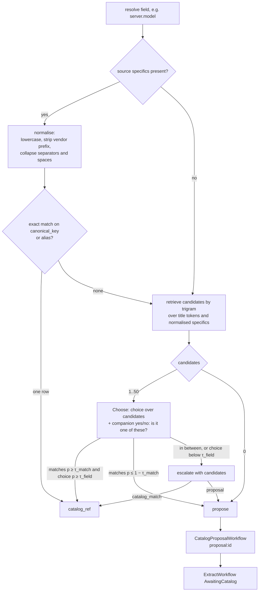

<!-- markdownlint-disable-file MD025 MD041 -->

# DESIGN-0005: Catalog: canonical identities, retrieval and proposals

<!--toc:start-->
<!-- markdownlint-capture -->
<!-- markdownlint-disable MD013 -->
- [Overview](#overview)
- [Goals and Non-Goals](#goals-and-non-goals)
  - [Goals](#goals)
  - [Non-Goals](#non-goals)
- [Background](#background)
- [Detailed Design](#detailed-design)
  - [What a row is](#what-a-row-is)
  - [Resolution](#resolution)
  - [Proposals](#proposals)
  - [Alias growth](#alias-growth)
  - [Seeding](#seeding)
- [API / Interface Changes](#api--interface-changes)
- [Data Model](#data-model)
- [Testing Strategy](#testing-strategy)
- [Migration / Rollout Plan](#migration--rollout-plan)
- [Open Questions](#open-questions)
- [References](#references)
<!-- markdownlint-restore -->
<!--toc:end-->

<!--docz:overview:start-->
## Overview

This document specifies `pkg/resolve` and the catalog tables: how a
string field the registry marks `resolve` becomes a `catalog_ref`, what a
catalog row is per component type, how candidates are retrieved with
`pg_trgm` and aliases, how the chooser question is built, what 'none of these'
means, how the escalator's proposals become rows through
`CatalogProposalWorkflow` and the operator's approval, and how the
catalog is seeded. ADR-0004 records why a catalog and not rules.

<!--docz:overview:end-->

## Goals and Non-Goals

<!--docz:goals:start-->
### Goals

- Every spelling of the same model lands on the same row, so product
  keys and baselines do not fragment.
- A model the catalog does not know is detected as 'none of these', measured, and
  proposed, never forced onto the nearest row.
- Catalog growth is proposed by the system with evidence and approved by
  the operator with edits, in one click from the review page.
- Retrieval works on the Postgres already deployed, with no new service.
- Seeding from existing data is one command and one approval pass.

<!--docz:goals:end-->

<!--docz:non-goals:start-->
### Non-Goals

- A general product database. Rows exist for the component types the
  registry declares and only for the attributes keys and scoring need.
- Cataloguing memory and drive part numbers. Their keys are typed
  attributes; the part number is an optional resolved string.
- Automatic approval. Revisit when proposal precision has been measured.

<!--docz:non-goals:end-->

<!--docz:background:start-->
## Background

Facts this design depends on:

- Jev's `choice` accepts up to 255 options; TypeSafe documents a
  two-stage score-then-choose pattern for larger sets.
- `pg_trgm` provides `similarity()` and the `%` operator with GIN index
  support (`gin_trgm_ops`); a `text[]` column indexes with the default
  GIN opclass for `@>` and `&&`.
- eBay item specifics commonly carry `Brand`, `Model`, `MPN` and
  `Manufacturer Part Number`, inconsistently filled and often with the
  vendor prefix repeated or omitted.

The first implementation's canonicalisers show the failure shape the
catalog replaces: a vendor and line map, a line denylist added after 31
Precision T3620 listings landed under `workstation:dell:poweredge:t3620`,
and a GPU model and family canonicaliser with a family override because
the model alternated between "Tesla" and "Ampere". Its distinct product
keys and item specifics are the seed data.

<!--docz:background:end-->

<!--docz:detailed-design:start-->
## Detailed Design

### What a row is

| Column | Meaning |
| --- | --- |
| `component_type` | registry key (`server`, `cpu`, `gpu`, `workstation`, `desktop`, `nic`) |
| `canonical_key` | the slug the product-key template uses: `dell:r740xd`, `intel:xeon:6248r`, `nvidia:tesla:p40` |
| `display_name` | what the chooser and the UI show: `Dell PowerEdge R740xd` |
| `attributes` | JSON per type (below) |
| `aliases` | strings sellers use: `R740XD`, `PE R740xd`, `PowerEdge R740 XD` |

Attributes per type, used by key templates and scoring:

| Type | Attributes |
| --- | --- |
| `server`, `workstation`, `desktop` | `vendor`, `line`, `model`, `generation`, `form_factor`, `max_drive_bays`, `sockets` |
| `cpu` | `vendor`, `family`, `model`, `cores`, `threads`, `base_clock_ghz`, `tdp_watts`, `socket`, `launch_year` |
| `gpu` | `vendor`, `family`, `model`, `vram_gb`, `memory_type`, `tdp_watts`, `form_factor`, `launch_year` |
| `nic` | `vendor`, `model`, `ports`, `speed_gbps`, `port_type`, `form_factor` |

Open-numeric facts (TDP, clocks, VRAM) live here, not in questions.

### Resolution



Normalisation is the only string handling in the pipeline and is
deliberately dumb: lowercase, strip a leading vendor name that the
registry's `classify` already implies, collapse `-`, `_`, `/` and runs
of spaces to one space, trim. It exists to make exact and alias matches
hit; it never produces a key.

Retrieval, with `q` as the normalised specifics value or, absent that,
the title with the vendor word and generic words removed:

```sql
SELECT id, canonical_key, display_name, attributes,
       GREATEST(similarity(display_name, $1),
                (SELECT COALESCE(MAX(similarity(a, $1)), 0) FROM unnest(aliases) a)) AS sim
FROM catalog
WHERE component_type = $2
  AND (display_name % $1 OR EXISTS (SELECT 1 FROM unnest(aliases) a WHERE a % $1))
ORDER BY sim DESC
LIMIT $3;   -- 50 default, 255 hard cap
```

`pg_trgm.similarity_threshold` is set per session to the configured
value (default 0.3). If the result hits the hard cap, retrieval re-runs
narrowed by `attributes->>'vendor'` when the specifics carry a brand.

The chooser question is built at runtime by `Component.Choose`:

```text
choice "catalog_match":
  question: "Which catalogued model is this listing for?"
  options:
    dell:r740xd  = "Dell PowerEdge R740xd — 2U, 12x3.5 or 24x2.5 bays, 2 sockets, 14th gen"
    dell:r740    = "Dell PowerEdge R740 — 2U, 8 or 16x2.5 bays, 2 sockets, 14th gen"
    dell:r640    = "Dell PowerEdge R640 — 1U, 8 or 10x2.5 bays, 2 sockets, 14th gen"

bool "matches_catalog":
  question: "Is the listing's model one of the catalogued models offered above?"
  true:  "the title or specifics name one of the offered models or a clear alias of it"
  false: "a different model, a different vendor, or the model cannot be told"
```

Criteria are rendered from `display_name` and a per-type attribute
template so the model has the distinguishing facts, not just names. The
companion yes/no question replaces a `none` option: the decision-model
guidance is that a `choice` always picks one option, so "none of these"
is better asked as its own question, and the same two questions compile
to one schema for the text-model deciders (DESIGN-0003).

The pair gives three outcomes, each logged with both distributions:

| Outcome | Meaning | Next |
| --- | --- | --- |
| `matches_catalog` ≥ `τ_match` (0.70) and the chosen option ≥ `τ_field` | confident match | `catalog_ref` |
| `matches_catalog` ≤ 1 − `τ_match` (0.30) | confidently not any candidate | propose |
| anything else | could be two of these, or unsure | escalate with the candidates attached |

### Proposals

A proposal is written by the `ProposeCatalog` activity from the
escalator's output (or from a confident 'none of these' with the retrieval
evidence):

```json
{
  "component_type": "server",
  "proposed": {
    "canonical_key": "dell:r7525",
    "display_name": "Dell PowerEdge R7525",
    "attributes": {"vendor": "dell", "line": "poweredge", "model": "r7525", "generation": "15", "form_factor": "2U", "sockets": 2},
    "aliases": ["R7525", "PowerEdge R7525"]
  },
  "from_item_id": "v1|1234567890|0",
  "evidence": "Title and specifics state PowerEdge R7525; AMD EPYC 7002; no R7525 row in catalog; nearest R7515 (1 socket)."
}
```

Deduplication key: `component_type` plus the normalised proposed
`canonical_key`. `ProposeCatalog` uses signal-with-start on
`proposal:<dedupe-key>` so a second listing proposing the same row joins
the existing wait and is recorded as a waiter on the proposal row.

```mermaid
sequenceDiagram
    participant E as ExtractWorkflow
    participant A as ProposeCatalog activity
    participant P as CatalogProposalWorkflow
    participant O as Operator via API
    participant S as store

    E->>A: proposal, waiter = my workflow ID
    A->>S: upsert catalog_proposals (status pending), add waiter
    A->>P: SignalWithStart proposal:<key> (waiter-added)
    E->>E: stage AwaitingCatalog; wait catalog-resolved
    O->>P: catalog-approve {edits, by}
    P->>S: ApplyCatalogDecision: insert catalog row (edits applied), proposal approved_as, decided_by
    P->>E: catalog-resolved {catalog_ref}
    E->>E: back to Resolving with the new row
```

Approval takes edits (every attribute and the alias list), so the
operator fixes a proposal rather than rejecting and re-creating it. On
reject, waiters receive `rejected: true` and go to `AwaitingLabel`,
where the operator can set a `catalog_ref` by hand. The pending
proposals list carries `nearest[]`, the top three existing rows by
trigram, so duplicates are obvious before approval.

### Alias growth

When an operator label sets a `catalog_ref` for a listing whose
normalised specifics or title did not match that row, the normalised
string is written as an alias proposal on the same row. Aliases are how exact-match recall improves without touching the
model.

### Seeding

`spt catalog seed --from-v1 <dsn> [--component t]`:

1. Reads the first implementation's distinct `product_key` values per
   component and the `Model`, `MPN` and `Brand` item specifics of the
   listings behind them.
2. Groups by normalised model string; for each group emits one proposal
   with the most common spelling as `display_name`, every other spelling
   as an alias, attribute values where the key encoded them (vendor,
   line, VRAM) and `evidence` naming the listing count.
3. Writes proposals, not rows. The operator approves them on the review
   page in one pass; `spt catalog approve --all --component cpu` exists
   for the pass where the proposals are obviously right.

Expected size: low hundreds of server and workstation models, a few
hundred CPU SKUs, under a hundred GPU models. Vendor spec sheets and
eBay's product catalog are additional seed sources for attributes, fed
in as proposals by a later tool if trigram recall on the golden dataset
asks for them.

<!--docz:detailed-design:end-->

<!--docz:api-changes:start-->
## API / Interface Changes

- `pkg/resolve`: `Normalise`, `Retrieve(ctx, store, componentType, q,
  limit)`, `BuildChooser(component, candidates)`, `Dedupe(proposal)`.
- Configuration: `catalog { similarity_threshold = 0.3, candidate_limit
  = 50, match_threshold = 0.70 }` block added to `spt.hcl`.
- API: `GET /api/v1/catalog?component=&q=&cursor=`,
  `POST /api/v1/catalog` (direct row create, operator only),
  `GET /api/v1/catalog/{id}`, `PUT /api/v1/catalog/{id}`,
  `GET /api/v1/catalog/proposals?status=&cursor=`,
  `POST /api/v1/catalog/proposals/{id}/approve`,
  `POST /api/v1/catalog/proposals/{id}/reject` (DESIGN-0006).
- CLI: `spt catalog seed`, `spt catalog list`, `spt catalog approve
  <id> | --all`, `spt catalog reject <id>`.
- Signals: `catalog-approve`, `catalog-reject`, `catalog-resolved`
  (DESIGN-0002).

<!--docz:api-changes:end-->

<!--docz:data-model:start-->
## Data Model

Owns `catalog` and `catalog_proposals` (schema in DESIGN-0001) plus:

- `catalog_proposal_waiters(proposal_id, workflow_id)`: the
  `ExtractWorkflow` IDs to signal on decision.
- Indexes: `catalog (component_type, canonical_key)` unique, `catalog
  using gin (display_name gin_trgm_ops)`, `catalog using gin (aliases)`,
  `catalog_proposals (status, created_at)`, a unique partial index on
  `(component_type, dedupe_key) where status = 'pending'`.
- `listings.catalog_ref` references `catalog.id`; deleting a catalog row
  is refused while listings reference it (merge is `PUT` with a
  `merge_into` field that repoints listings and unions aliases).

Extension: `pg_trgm`, created by migration `001`.

<!--docz:data-model:end-->

<!--docz:testing:start-->
## Testing Strategy

- `Normalise`: table-driven on real spellings from the golden dataset.
- Retrieval: integration tests on testcontainers Postgres with a
  fixture catalog of 200 rows; recall at 50 on the golden dataset's
  server, CPU and GPU listings reported by the regression runner.
- Chooser: the built question set is validated by `decidertest`
  (option count, unique keys, the companion `matches_catalog` question
  present).
- Proposal workflow: SDK test suite for approve with edits, reject,
  timeout, duplicate signal-with-start, waiter fan-out.
- Seeding: a fixture export of the first implementation's tables
  produces the expected proposal set; idempotent on re-run.
- Merge: repointing listings and alias union under concurrent reads.

<!--docz:testing:end-->

<!--docz:rollout:start-->
## Migration / Rollout Plan

1. Tables, normalisation, retrieval and chooser against a fixture
   catalog (RFC-0001 phase 2).
2. Seed from the first implementation into the dev database as
   proposals; one approval pass in the UI; measure recall on the golden
   dataset.
3. `CatalogProposalWorkflow` live on the dev namespace; proposal rate
   and escalation rate watched for two weeks.
4. Alias proposals from labels enabled once the review page is in use.

<!--docz:rollout:end-->

<!--docz:open-questions:start-->
## Open Questions

All questions below were decided on 2026-11-06; the chosen option is
recorded and the alternatives are dropped. The body of the design
reflects the decision.

**Q1. Where does seeding run?** Decided (2026-11-06): option a.
Locally by the operator during integration, reading the first implementation's CNPG database over the cluster network and writing proposals to the `spt-dev` database.

**Q2. Trigram threshold and ranking.** Decided (2026-11-06): option a.
`similarity_threshold` 0.3 with ranking by the best of display name and aliases, vendor narrowing only when the cap is hit.

**Q3. Alias growth from labels.** Decided (2026-11-06): option a.
An operator label that sets a `catalog_ref` the string did not match writes an alias proposal on that row, approved like any proposal.

**Q4. Proposals from a confident 'none of these' without escalation.** Decided (2026-11-06): option a.
A confident 'none of these' goes to the escalator first, which writes a proposal with attributes and evidence; the chooser alone never proposes.

**Q5. Catalog rows for memory and drive part numbers.** Decided (2026-11-06): option a.
No. Keys come from typed attributes; part number is an optional resolved string with `catalog = false`.

<!--docz:open-questions:end-->

<!--docz:references:start-->
## References

- [RFC-0001 spt: durable execution of typed decisions over watched eBay listings](../rfc/0001-spt-durable-execution-of-typed-decisions-over-watched-ebay.md)
- [ADR-0004 Canonical identities come from a catalog grown by proposal and approval](../adr/0004-canonical-identities-come-from-a-catalog-grown-by-proposal-and.md)
- [DESIGN-0002 Durable execution](../design/0002-durable-execution-workflows-activities-queues-and-signals.md); [DESIGN-0003 Decisions](../design/0003-decisions-the-decider-contract-cascade-escalation-and.md); [DESIGN-0004 Registry](../design/0004-registry-the-domain-schema-as-an-embedded-hcl-file.md); [DESIGN-0007 Operator UI](../design/0007-operator-ui-alerts-review-catalog-and-runs.md)
- [PostgreSQL `pg_trgm`](https://www.postgresql.org/docs/current/pgtrgm.html)
- [TypeSafe API reference](https://docs.typesafe.ai/api)
- [server-price-tracker `pkg/extract/system_normalize.go`](https://github.com/donaldgifford/server-price-tracker/blob/main/pkg/extract/system_normalize.go) and [`gpu_normalize.go`](https://github.com/donaldgifford/server-price-tracker/blob/main/pkg/extract/gpu_normalize.go); [DESIGN-0012 Add GPU](https://github.com/donaldgifford/server-price-tracker/blob/main/docs/design/0012-add-gpu-as-a-new-component-type.md); [DESIGN-0015 Add workstation and desktop](https://github.com/donaldgifford/server-price-tracker/blob/main/docs/design/0015-add-workstation-and-desktop-as-component-types.md)

<!--docz:references:end-->
