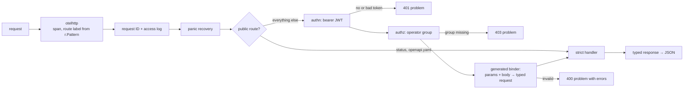
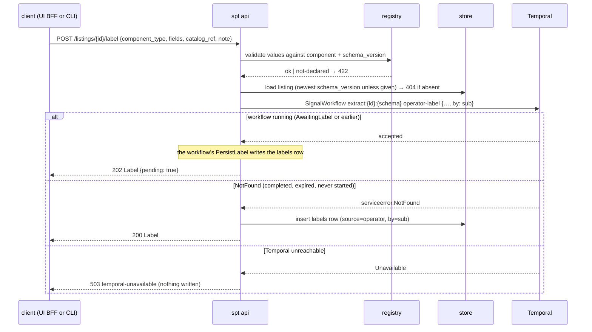

<!-- markdownlint-disable-file MD025 MD041 -->

# DESIGN-0006: API: the OpenAPI contract, authentication and clients

<!--toc:start-->
<!-- markdownlint-capture -->
<!-- markdownlint-disable MD013 -->
- [Overview](#overview)
- [Goals and Non-Goals](#goals-and-non-goals)
  - [Goals](#goals)
  - [Non-Goals](#non-goals)
- [Background](#background)
- [Detailed Design](#detailed-design)
  - [The document](#the-document)
  - [Resources and endpoints](#resources-and-endpoints)
  - [Paging](#paging)
  - [Problem documents](#problem-documents)
  - [Authentication and authorisation](#authentication-and-authorisation)
  - [Implementation layout](#implementation-layout)
  - [POST /decide](#post-decide)
  - [Code generation and checks](#code-generation-and-checks)
  - [The spt CLI client](#the-spt-cli-client)
- [API / Interface Changes](#api--interface-changes)
- [Data Model](#data-model)
- [Testing Strategy](#testing-strategy)
- [Migration / Rollout Plan](#migration--rollout-plan)
- [Open Questions](#open-questions)
- [References](#references)
<!-- markdownlint-restore -->
<!--toc:end-->

<!--docz:overview:start-->
## Overview

This document specifies the HTTP API the `spt api` role serves: the
OpenAPI document that is the contract, every resource and endpoint,
keyset paging, problem documents, bearer-JWT authentication and the
operator-group authorisation, the middleware chain on `net/http`, the
strict-server implementation under `internal/api`, the code generation
that produces the server, the CLI client and the UI types from one file,
and the `spt` CLI that consumes it. ADR-0006 records why spec-first on
the standard library; DESIGN-0001 gives the role and its boot order;
DESIGN-0002 gives the workflows the API starts and signals; DESIGN-0007
is the UI that is the API's main consumer.

<!--docz:overview:end-->

## Goals and Non-Goals

<!--docz:goals:start-->
### Goals

- `api/openapi.yaml` exists before any handler and is the only source
  for the Go server, the Go client and the TypeScript types.
- Every endpoint is one of: a read over Postgres, a write to Postgres, a
  workflow start, a workflow signal, or a visibility query. Nothing runs
  inline that could take longer than a database round trip.
- Every error is an RFC 9457 problem document with a stable `type`.
- Every list pages by an opaque keyset cursor; no offset paging.
- Authentication is on from the first endpoint; only `status` and the
  spec itself are public.
- The api role holds no workflow code; it refers to workflows, signals
  and queues by name.

<!--docz:goals:end-->

<!--docz:non-goals:start-->
### Non-Goals

- Streaming or long-polling. Clients poll.
- Per-user authorisation. One operator group; the structure allows
  per-watch scopes later.
- A runtime documentation UI. The spec is served as YAML; a browser
  renderer is a client's concern.
- Backwards compatibility across major versions. There is one version
  path and the UI and CLI release with the server.

<!--docz:non-goals:end-->

<!--docz:background:start-->
## Background

ADR-0006 chose spec-first OpenAPI generated into a strict server on
`net/http.ServeMux` with method-and-pattern routing, `otelhttp` and
plain `http.Handler` middleware, oapi-codegen for the server and client,
vacuum for linting, RFC 9457 for errors, keyset cursors for lists and
OIDC bearer JWTs for authentication. ADR-0007 puts the UI behind a Bun
BFF that forwards the user's bearer token and confines writes to an
allowlist, so the API sees the same bearer whether the caller is the
UI, the CLI or `curl`.

Facts this design depends on:

- Go's `ServeMux` routes by `METHOD /path/{param}` patterns and exposes
  the matched pattern as `r.Pattern`, which `otelhttp` can use as the
  route label.
- oapi-codegen's `std-http-server` target emits a `ServerInterface`,
  a `StrictServerInterface` with typed request and response objects,
  a `HandlerWithOptions` router onto a `ServeMux`, and models; the
  `embedded-spec` option embeds the document for serving.
- vacuum lints an OpenAPI document against a ruleset and fails on
  severity.
- Temporal's Go client returns `serviceerror.NotFound` when signalling a
  workflow that does not exist or has closed, and
  `serviceerror.WorkflowExecutionAlreadyStarted` on a duplicate start.

repo-guardian serves its API this way on the same cluster: a
hand-written spec, a strict server on two muxes (public and protected),
middleware in the order given below, problem documents, cursors, a JWKS
verifier and a group check, a generated client, and a UI whose
generated types are drift-checked in CI. That code is the reference for
the handler, auth, paging and problem packages here; the resources are
spt's own.

<!--docz:background:end-->

<!--docz:detailed-design:start-->
## Detailed Design

### The document

`api/openapi.yaml`, OpenAPI 3.1, one file. Layout:

```yaml
openapi: 3.1.0
info:
  title: spt
  version: v1          # the path version; the release tag is in x-spt-version at build time
servers:
  - url: /api/v1
security:
  - bearer: []         # default for every operation; public ones override with `security: []`
tags: [watches, listings, alerts, baselines, catalog, runs, decisions, registry, ingest, quota, status]
components:
  securitySchemes:
    bearer: { type: http, scheme: bearer, bearerFormat: JWT }
  parameters:
    cursor:   { name: cursor, in: query, schema: { type: string } }
    limit:    { name: limit, in: query, schema: { type: integer, minimum: 1, maximum: 200, default: 50 } }
    schemaVersion: { name: schema_version, in: query, schema: { type: string } }
  schemas:
    Problem: ...
    Page_<Resource>: { items: [...], next_cursor: string | null }
    Watch, WatchInput, Listing, Decision, Label, LabelInput, Alert, Baseline,
    CatalogRow, CatalogRowInput, Proposal, ProposalDecision, Run, JournalEntry,
    DecideInput, DecideResult, CalibrationTable, Registry, IngestInput, StartedWorkflow,
    Quota, Status
paths: ...
```

Conventions that vacuum enforces through `api/vacuum.yaml`:

- Every operation has an `operationId` (`listWatches`, `getListing`,
  `labelListing`, …) that becomes the Go method name and the TypeScript
  key.
- Every operation declares `4XX` and `5XX` responses as
  `application/problem+json` with the `Problem` schema.
- Every list response is a `Page_*` envelope and accepts `cursor` and
  `limit`.
- Every write has a request body schema with `additionalProperties:
  false`.
- IDs are strings. Timestamps are RFC 3339. Money is a decimal string
  with a currency field.

Excerpt for one endpoint and the Problem schema:

```yaml
paths:
  /listings/{id}/label:
    post:
      operationId: labelListing
      tags: [listings]
      summary: Record an operator label and resume the listing's workflow if it is waiting.
      parameters:
        - { name: id, in: path, required: true, schema: { type: string } }
        - $ref: '#/components/parameters/schemaVersion'
      requestBody:
        required: true
        content:
          application/json:
            schema: { $ref: '#/components/schemas/LabelInput' }
      responses:
        '202':
          description: Label recorded and signal delivered.
          content: { application/json: { schema: { $ref: '#/components/schemas/Label' } } }
        '200':
          description: Label recorded; no workflow was waiting.
          content: { application/json: { schema: { $ref: '#/components/schemas/Label' } } }
        '400': { $ref: '#/components/responses/Problem' }
        '404': { $ref: '#/components/responses/Problem' }
        '503': { $ref: '#/components/responses/Problem' }

components:
  schemas:
    LabelInput:
      type: object
      additionalProperties: false
      required: [component_type, fields]
      properties:
        component_type: { type: string }
        fields: { type: object, additionalProperties: { type: string } }
        catalog_ref: { type: string }
        note: { type: string, maxLength: 2000 }
    Problem:
      type: object
      required: [type, title, status]
      properties:
        type:     { type: string, format: uri }
        title:    { type: string }
        status:   { type: integer }
        detail:   { type: string }
        instance: { type: string }
        errors:
          type: array
          items:
            type: object
            required: [field, message]
            properties: { field: { type: string }, message: { type: string } }
```

### Resources and endpoints

All paths are under `/api/v1`. "Auth" is `operator` (bearer with the
operator group) or `public` (`security: []`). "Effect" names what the
handler does beyond reading Postgres.

| Resource | Method and path | Auth | Request → response | Effect |
| --- | --- | --- | --- | --- |
| watches | `GET /watches` | operator | `cursor`, `limit`, `enabled` → `Page_Watch` | — |
| | `POST /watches` | operator | `WatchInput` → `Watch` (201) | creates Schedule `watch:<id>` |
| | `GET /watches/{id}` | operator | → `Watch` | — |
| | `PUT /watches/{id}` | operator | `WatchInput` → `Watch` | updates the Schedule spec |
| | `DELETE /watches/{id}` | operator | → 204 | deletes the Schedule; listings are kept |
| | `PUT /watches/{id}/enabled` | operator | `{enabled}` → `Watch` | pauses or unpauses the Schedule |
| listings | `GET /listings` | operator | `stage`, `watch`, `type`, `schema_version`, `active`, `cursor`, `limit` → `Page_Listing` | — |
| | `GET /listings/{id}` | operator | `schema_version` (default newest) → `Listing` with `other_versions[]` | — |
| | `GET /listings/{id}/decisions` | operator | `schema_version` → `{decisions[], labels[], escalation, resolve_steps[]}` | — |
| | `POST /listings/{id}/label` | operator | `LabelInput` → `Label` (202 or 200) | signals `operator-label`; falls back to a direct write |
| alerts | `GET /alerts` | operator | `watch`, `type`, `verdict`, `min_score`, `delivered`, `dismissed`, `since`, `cursor`, `limit` → `Page_Alert` | — |
| | `GET /alerts/{id}` | operator | → `Alert` with `listing`, `score_breakdown`, `baseline` | — |
| | `POST /alerts/{id}/dismiss` | operator | `{note}` → `Alert` | writes `labels(source=dismiss)`; pushes a Langfuse score |
| | `POST /alerts/{id}/restore` | operator | → `Alert` | clears `dismissed_at`; Langfuse score |
| baselines | `GET /baselines` | operator | `component`, `cursor`, `limit` → `Page_Baseline` | — |
| | `GET /baselines/{product_key}` | operator | → `Baseline` with sample listings | — |
| | `POST /baselines/refresh` | operator | → `StartedWorkflow` (202) | starts `BaselineWorkflow` |
| catalog | `GET /catalog` | operator | `component`, `q`, `cursor`, `limit` → `Page_CatalogRow` | trigram search when `q` is set |
| | `POST /catalog` | operator | `CatalogRowInput` → `CatalogRow` (201) | direct row create |
| | `GET /catalog/{id}` | operator | → `CatalogRow` with `listing_count` | — |
| | `PUT /catalog/{id}` | operator | `CatalogRowInput` with optional `merge_into` → `CatalogRow` | repoints listings on merge |
| | `GET /catalog/proposals` | operator | `status` (default `pending`), `component`, `cursor`, `limit` → `Page_Proposal` with `nearest[]` | — |
| | `POST /catalog/proposals/{id}/approve` | operator | `{edits}` → `Proposal` (202) | signals `catalog-approve` to `proposal:<key>` |
| | `POST /catalog/proposals/{id}/reject` | operator | `{reason}` → `Proposal` (202) | signals `catalog-reject` |
| runs | `GET /runs` | operator | `type`, `stage`, `watch`, `component`, `schema_version`, `status`, `cursor`, `limit` → `Page_Run` | Temporal visibility `ListWorkflow` |
| | `GET /runs/{workflow_id}` | operator | → `Run` with current stage from the `stage` query | `DescribeWorkflowExecution` + query |
| | `GET /runs/{workflow_id}/journal` | operator | → `{entries[]}` | `GetWorkflowHistory` filtered to activity and signal events |
| decisions | `POST /decide` | operator | `DecideInput` (`item_id` or `state`, `component`) → `DecideResult` | calls the cascade inline; budgeted; rate-limited |
| | `GET /decisions/stats` | operator | `since` → counts per question, decider, outcome | — |
| | `GET /decisions/calibration` | operator | `since`, `question`, `decider` → `CalibrationTable` | — |
| registry | `GET /registry` | operator | → `Registry` (`schema_version`, components, questions, options, criteria) | — |
| ingest | `POST /ingest` | operator | `IngestInput` (`watch_id`, `full`, `schema_version`) → `StartedWorkflow` (202) | starts `IngestWorkflow` |
| | `DELETE /ingest/{workflow_id}` | operator | → 202 | signals `cancel-tick` |
| quota | `GET /quota` | operator | → `Quota` (eBay day usage and limit, budgets remaining) | — |
| status | `GET /status` | public | → `Status` | Temporal ping, `DescribeBacklog`, counts |
| spec | `GET /openapi.yaml` | public | → the embedded document | — |

`StartedWorkflow` is `{workflow_id, run_id}`. A start that hits
`WorkflowExecutionAlreadyStarted` returns 200 with the existing IDs
rather than an error, because the caller's intent is satisfied.

### Paging

Every list is keyset-paged. The cursor is an opaque, URL-safe base64
string encoding the sort key values of the last row returned plus a
version byte and an HMAC under a per-process key, so a client cannot
forge one and a changed sort breaks cleanly with 400 rather than
returning the wrong page.

| List | Sort | Cursor payload |
| --- | --- | --- |
| watches | `name asc, id asc` | `(name, id)` |
| listings | `last_seen desc, ebay_item_id asc` | `(last_seen, ebay_item_id)` |
| alerts | `created_at desc, id asc` | `(created_at, id)` |
| baselines | `product_key asc` | `(product_key)` |
| catalog | `component_type asc, display_name asc, id asc`; with `q`, `sim desc, id asc` | `(component_type, display_name, id)` or `(sim, id)` |
| proposals | `created_at asc, id asc` (oldest first) | `(created_at, id)` |
| runs | Temporal's `NextPageToken` | the token, wrapped |

`limit` defaults to 50 and caps at 200. `next_cursor` is `null` on the
last page. Filters are part of the HMAC input so a cursor from one
filter set is rejected on another.

### Problem documents

Every non-2xx response is `application/problem+json`. `type` is a URI
under `https://spt.dev/problems/`; `instance` is the request path;
`title` is fixed per type; `detail` is human text; `errors[]` carries
field-level validation messages.

| Type | Status | When |
| --- | --- | --- |
| `validation` | 400 | request body or parameter fails the schema or a handler check; `errors[]` populated |
| `bad-cursor` | 400 | cursor fails to decode or its HMAC |
| `unauthenticated` | 401 | missing or invalid bearer; `WWW-Authenticate: Bearer` set |
| `forbidden` | 403 | valid token without the operator group |
| `not-found` | 404 | no such watch, listing, alert, row, proposal or workflow |
| `conflict` | 409 | duplicate watch name; catalog key already exists; proposal already decided |
| `label-not-accepted` | 422 | label values are not declared options for the component and registry version |
| `budget-exhausted` | 429 | `POST /decide` when the decide budget for the day is spent; `Retry-After` to midnight UTC |
| `rate-limited` | 429 | `POST /decide` above one request per second per token |
| `temporal-unavailable` | 503 | the Temporal client call failed to connect or timed out; `Retry-After: 5` |
| `database-unavailable` | 503 | the pool cannot acquire a connection |
| `internal` | 500 | anything else; the request ID is in `detail` |

Mapping from Temporal errors in the api role:

| Temporal error | Problem |
| --- | --- |
| `serviceerror.NotFound` on signal | not an error for `label` (see below); `not-found` for proposals and `cancel-tick` |
| `serviceerror.WorkflowExecutionAlreadyStarted` on start | 200 with the existing IDs |
| `serviceerror.Unavailable`, deadline exceeded, connection refused | `temporal-unavailable` |
| `serviceerror.InvalidArgument` | `internal` (a bug in the api role) |

### Authentication and authorisation



Authentication (`internal/api/authn.go`):

- Configuration from `OIDC_ISSUER`, `OIDC_AUDIENCE`; discovery at
  start (`/.well-known/openid-configuration`) with the JWKS URL cached;
  keys refreshed every hour and on an unknown `kid`, with a one-minute
  floor between refreshes.
- Accepts `RS256` and `ES256`; rejects `none` and HMAC algorithms.
- Checks `iss`, `aud` (string or array containing the audience), `exp`
  and `nbf` with 60 seconds of skew, and `iat` not in the future beyond
  skew.
- The verified claims (`sub`, `groups`, `email` if present) are put on
  the request context; handlers read `sub` for `labels.by`.
- `--insecure-no-auth` skips verification and sets a fixed `sub` of
  `dev`. It refuses to start unless `LISTEN_ADDR` is loopback, and logs
  at `warn` on every start.

Authorisation (`internal/api/authz.go`): the `groups` claim (name
configurable, default `groups`) must contain `OIDC_OPERATOR_GROUP`.
Operations declared `security: []` in the spec are routed on the public
mux and skip both steps; the public list is derived from the embedded
spec at start so the two cannot drift.

The BFF (DESIGN-0007) forwards the signed-in user's access token
unchanged, so `sub` on a label is the operator's OIDC subject, not a
service identity. The CLI sends a token it obtained itself (below).

### Implementation layout

```text
internal/api/
  server.go        New(opts) → http.Handler: two muxes (public, protected), middleware chain, route labelling
  middleware.go    requestID, accessLog, recoverer
  authn.go         JWKS verifier, claims type, context helpers
  authz.go         group check
  problem.go       Problem type, writeProblem, error → problem mapping incl. Temporal and pgx errors
  cursor.go        Encode/Decode with HMAC, per-list key types
  watches.go       strict-server methods for the watches tag
  listings.go      … listings, decisions view, label
  alerts.go
  baselines.go
  catalog.go       rows and proposals
  runs.go          visibility list, describe + query, history journal
  decisions.go     decide, stats, calibration
  registry.go
  ingest.go
  quota.go
  status.go
  gen/             api.gen.go (server, models, embedded spec); never edited
  client/          client.gen.go (Go client for the CLI and contract tests)
```

Handler rules:

- One file per tag; each file implements that tag's methods of
  `gen.StrictServerInterface` on the `server` struct.
- Reads go through `internal/store` interfaces with context deadlines
  from `server.read_timeout`; writes through the same store in one
  transaction per request.
- Workflow starts and signals go through a `temporalclient` interface
  with four methods (`Start`, `Signal`, `SignalWithStart`, `Query`) plus
  a `visibility` interface (`List`, `Describe`, `History`); the api role
  calls them with the constants in `internal/workflows/names`
  (`WorkflowIngest`, `SignalOperatorLabel`, `QueueDefault`, …) and
  typed payload structs from `internal/domain`. depguard denies any
  other import from the workflow tree.
- Handlers return typed response objects; the generated
  `ResponseErrorHandlerFunc` and `RequestErrorHandlerFunc` are wired to
  `problem.go` so binding failures and handler errors become problems
  with the same shape.
- Handlers never log request bodies; the access log carries method,
  pattern, status, duration, request ID and `sub`.

The label endpoint, which is the signal path with a fallback:



The direct write is the decided behaviour (DESIGN-0002 Q3): a label
on a finished listing counts for calibration and resumes nothing.

### `POST /decide`

Runs the configured cascade inline against either a stored listing's
state (`item_id` plus optional `schema_version`) or a caller-supplied
`state` text and `component`. It exists for the why panel's re-ask and
for the CLI's `spt decide`. Guards: the `decide` daily budget is checked
and charged exactly as the activity does; one request per second per
`sub` with a burst of five, enforced in the handler with an in-memory
limiter (one api replica); a 10-second handler deadline. The result
carries the answers, distributions, which decider answered each, usage
and cost, and is recorded to Langfuse under a session named
`api-decide:<sub>` so these calls never pollute a listing's session.

### Code generation and checks

```yaml
# api/oapi-codegen.yaml
package: gen
output: internal/api/gen/api.gen.go
generate:
  std-http-server: true
  strict-server: true
  models: true
  embedded-spec: true
output-options:
  skip-prune: true
  name-normalizer: ToCamelCaseWithInitialisms
```

A second config, `api/oapi-codegen.client.yaml`, generates
`internal/api/client/client.gen.go` with `client: true` and `models:
true` into package `client`.

| Recipe | Does |
| --- | --- |
| `just generate-api` | runs oapi-codegen for both configs, then `gofmt` on the output |
| `just lint-api` | `vacuum lint -r api/vacuum.yaml --fail-severity warn api/openapi.yaml`, then regenerates into a temp dir and fails on any diff against the committed files |
| `just ui-generate-api` | `openapi-typescript api/openapi.yaml -o ui/web/src/api/schema.gen.ts` |
| `bun run check:api` | regenerates `schema.gen.ts` and fails on diff; runs in the `ui` CI job |

CI runs `lint-api` in the Lint job and `check:api` in the UI job, so a
spec change that is not regenerated on either side fails before review.
`oapi-codegen`, `vacuum` and `openapi-typescript` are pinned in
`mise.toml` and `ui/package.json`.

### The `spt` CLI client

Client verbs (`watches`, `listings`, `alerts`, `baselines`, `catalog`,
`runs`, `decisions`, `ingest`, `decide`, `label`, `quota`, `status`) use
`internal/api/client`:

- `SPT_API_URL` (or `--api-url`) is the base; `SPT_TOKEN` (or
  `--token`) is the bearer. Without a token, `spt login` runs the OIDC
  device-authorisation flow against `SPT_OIDC_ISSUER` with
  `SPT_OIDC_CLIENT_ID` (a public client registered for the CLI), stores
  the refresh token in the OS keyring, and later verbs refresh silently.
- `--output table|json|yaml`; `table` is the default on a TTY, `json`
  otherwise. `--cursor` and `--all` drive paging; `--all` follows
  `next_cursor` to the end.
- Exit codes: 0 success, 1 problem response (the problem is printed as
  `title: detail`), 2 usage error, 3 connection error.
- Mutating verbs (`watches delete`, `catalog approve --all`) prompt
  unless `--yes`.
- `spt status` works without a token; everything else sends one.

<!--docz:detailed-design:end-->

<!--docz:api-changes:start-->
## API / Interface Changes

- New: everything above. There is no prior API in this repository; the
  scaffold's `serve` subcommand and its placeholder handler are removed.
- Files: `api/openapi.yaml`, `api/oapi-codegen.yaml`,
  `api/oapi-codegen.client.yaml`, `api/vacuum.yaml`, `internal/api/*`,
  `internal/api/gen/`, `internal/api/client/`.
- Configuration: the `server` block (DESIGN-0001) and the environment
  `OIDC_ISSUER`, `OIDC_AUDIENCE`, `OIDC_OPERATOR_GROUP`,
  `OIDC_GROUPS_CLAIM` (default `groups`); the `--insecure-no-auth` flag
  on `spt api` and `spt all`.
- CLI: the client verbs, `spt login`, `SPT_API_URL`, `SPT_TOKEN`,
  `SPT_OIDC_ISSUER`, `SPT_OIDC_CLIENT_ID`, `--output`.
- Chart: `api.auth.{issuer, audience, operatorGroup, groupsClaim}`
  rendered to the environment; `api.ingress` (off by default; the UI
  fronts the API).
- justfile: `generate-api`, `lint-api`, `ui-generate-api`.
- Health and metrics stay on `METRICS_ADDR` outside this mux.

<!--docz:api-changes:end-->

<!--docz:data-model:start-->
## Data Model

No tables of its own. Reads every table in DESIGN-0001. Writes:
`watches` (create, update, enable, delete), `labels` (dismiss, restore
and the label fallback, with `by` = OIDC `sub`), `alerts.dismissed_at`,
`catalog` (direct create, update, merge), `budgets('decide')` for
`POST /decide`. Everything else the API changes, it changes by
starting or signalling a workflow that writes through activities.
Visibility and history for `runs` come from Temporal, not Postgres.

<!--docz:data-model:end-->

<!--docz:testing:start-->
## Testing Strategy

- **Handlers**: each file's methods tested against
  `gen.StrictServerInterface` with mockery v3 mocks of the store, the
  Temporal client interface and the visibility interface; every problem
  mapping in the table above has a test.
- **Authn**: a test JWKS with RS256 and ES256 keys; expired, not-yet-valid,
  wrong issuer, wrong audience, unknown `kid` (triggers refresh), `alg:
  none`; the `--insecure-no-auth` loopback refusal.
- **Authz**: group present, absent, claim as string versus array,
  custom claim name.
- **Cursor**: round-trip per list type; tampered HMAC; cursor from a
  different filter set; `limit` bounds.
- **Public routes**: derived from the spec; a test asserts the set is
  exactly `status` and `openapi.yaml`.
- **Contract**: the generated Go client against an `httptest` server
  running the real handler chain with the mocked store, one call per
  operation, asserting status and decoded types; this is the test that
  catches a spec change the handlers did not follow.
- **Label fallback**: signal accepted, `NotFound` fallback writes the
  row, `Unavailable` writes nothing.
- **`POST /decide`**: budget charge, rate limit, deadline.
- **Lint**: `just lint-api` (vacuum at `warn`, regeneration drift) in
  CI; `check:api` in the UI job.
- **Integration** (`just test-integration`): the api role against
  testcontainers Postgres and the Temporal dev server; `POST /ingest`
  starts a workflow that the test observes; a label signal reaches a
  waiting `ExtractWorkflow`.

<!--docz:testing:end-->

<!--docz:rollout:start-->
## Migration / Rollout Plan

1. `api/openapi.yaml` written for every resource in the table; vacuum
   clean; generation wired; the strict server compiled with every method
   returning `not implemented` problems (RFC-0001 phase 1).
2. Read endpoints and the auth chain against the store; `status` public;
   the CLI's read verbs; the UI's generated types (phase 1, with
   DESIGN-0007 starting on the shell).
3. Write endpoints that only touch Postgres (watches, dismiss, restore,
   catalog rows) (phase 1).
4. Workflow-backed endpoints (ingest, label, proposals, baselines
   refresh, runs) once DESIGN-0002's workflows exist (phase 3).
5. `POST /decide` and the calibration endpoints with DESIGN-0003
   (phase 2 to 3).
6. Dev namespace behind the homelab issuer; the CLI's device flow
   registered as a public client (phase 4).

<!--docz:rollout:end-->

<!--docz:open-questions:start-->
## Open Questions

All questions below were decided on 2026-11-06; the chosen option is
recorded and the alternatives are dropped. The body of the design
reflects the decision.

**Q1. How is the API exposed?** Decided (2026-11-06): option a.
Cluster-internal only; the UI's BFF is the sole ingress, and the CLI reaches the API through the BFF's `/api` proxy with the same bearer. One exposure, one allowlist, no second Ingress.

**Q2. How does the CLI get a token?** Decided (2026-11-06): option a.
OIDC device-authorisation flow against the homelab issuer with a public client for the CLI, refresh token in the OS keyring, `SPT_TOKEN` as an override for scripts and CI.

**Q3. Is `POST /decide` in the first release?** Decided (2026-11-06): option a.
Yes, behind the budget and rate limit; the why panel's re-ask and `spt decide` are how thresholds and criteria get debugged during integration.

**Q4. Listing cursors across registry versions.** Decided (2026-11-06): option a.
`GET /listings` defaults to the newest `schema_version` per item and the cursor is over `(last_seen, ebay_item_id)` of that view, so a release mid-page does not reorder; `schema_version=` selects an explicit version.

**Q5. What backs `GET /runs`?** Decided (2026-11-06): option a.
Temporal visibility and history read by the api role, as DESIGN-0002 specifies; no new table; acceptable at single-operator volume.

**Q6. API versioning.** Decided (2026-11-06): option a.
`/api/v1` only, no negotiation; breaking changes are a `/api/v2` mux if they ever happen, and the UI and CLI ship with the server.

**Q7. Rate limiting state for one api replica.** Decided (2026-11-06): option b.
A Postgres-backed limiter from the start.

<!--docz:open-questions:end-->

<!--docz:references:start-->
## References

- [RFC-0001 spt: durable execution of typed decisions over watched eBay listings](../rfc/0001-spt-durable-execution-of-typed-decisions-over-watched-ebay.md)
- [ADR-0006 The API is a spec-first OpenAPI contract served on net/http](../adr/0006-the-api-is-a-spec-first-openapi-contract-served-on-nethttp.md)
- [ADR-0007 The operator UI is a React SPA behind a Bun BFF](../adr/0007-the-operator-ui-is-a-react-spa-behind-a-bun-bff.md)
- [DESIGN-0001 System architecture](../design/0001-system-architecture-roles-configuration-deployment-and-data.md); [DESIGN-0002 Durable execution](../design/0002-durable-execution-workflows-activities-queues-and-signals.md); [DESIGN-0003 Decisions](../design/0003-decisions-the-decider-contract-cascade-escalation-and.md); [DESIGN-0004 Registry](../design/0004-registry-the-domain-schema-as-an-embedded-hcl-file.md); [DESIGN-0005 Catalog](../design/0005-catalog-canonical-identities-retrieval-and-proposals.md); [DESIGN-0007 Operator UI](../design/0007-operator-ui-alerts-review-catalog-and-runs.md)
- [repo-guardian `internal/api`](https://github.com/donaldgifford/repo-guardian/tree/main/internal/api), [`api/openapi.yaml`](https://github.com/donaldgifford/repo-guardian/blob/main/api/openapi.yaml), [`api/oapi-codegen.yaml`](https://github.com/donaldgifford/repo-guardian/blob/main/api/oapi-codegen.yaml); [DESIGN-0027 v2 read-only API, business UI and status page](https://github.com/donaldgifford/repo-guardian/blob/main/docs/design/0027-v2-read-only-api-business-ui-and-status-page.md)
- [oapi-codegen](https://github.com/oapi-codegen/oapi-codegen); [vacuum](https://github.com/daveshanley/vacuum); [openapi-typescript](https://openapi-ts.dev)
- [Go 1.22 routing enhancements](https://go.dev/blog/routing-enhancements); [`otelhttp`](https://pkg.go.dev/go.opentelemetry.io/contrib/instrumentation/net/http/otelhttp)
- [RFC 9457 Problem Details for HTTP APIs](https://www.rfc-editor.org/rfc/rfc9457); [RFC 8628 OAuth 2.0 Device Authorization Grant](https://www.rfc-editor.org/rfc/rfc8628); [OpenID Connect Discovery](https://openid.net/specs/openid-connect-discovery-1_0.html)
- [Temporal Go SDK `serviceerror`](https://pkg.go.dev/go.temporal.io/api/serviceerror); [Temporal visibility list filter syntax](https://docs.temporal.io/list-filter)

<!--docz:references:end-->
