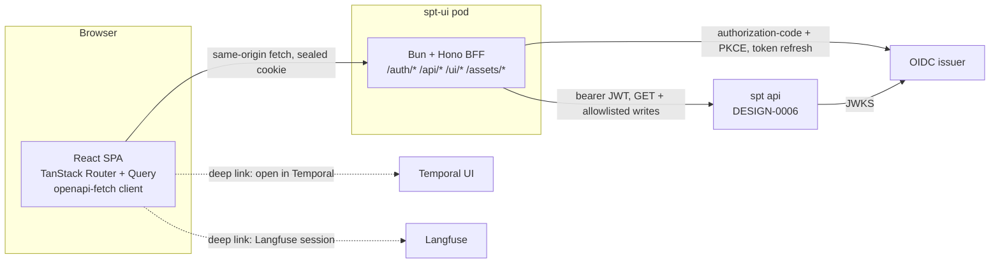
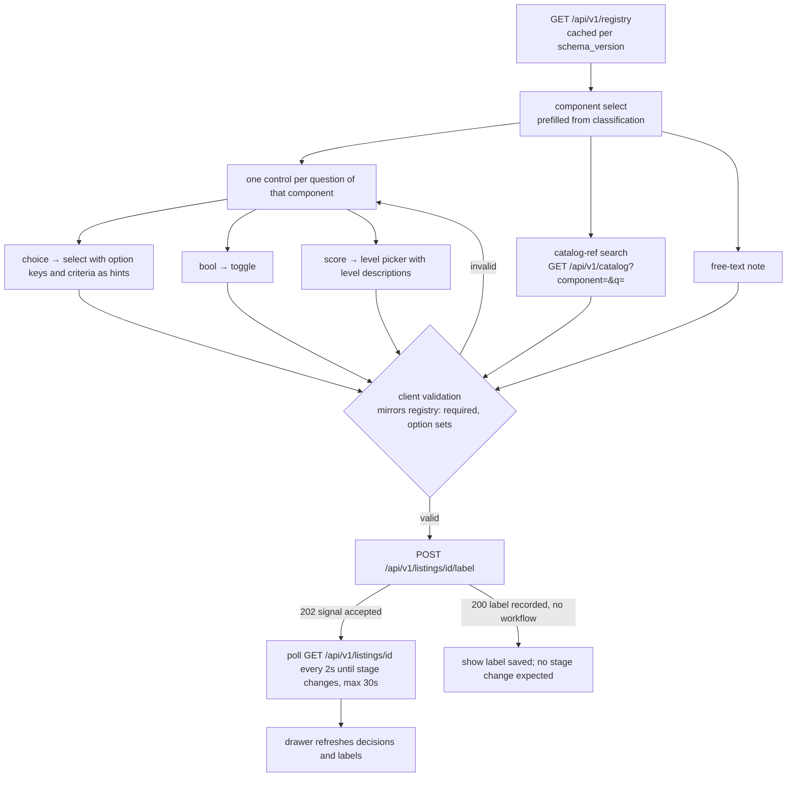

<!-- markdownlint-disable-file MD025 MD041 -->

# DESIGN-0007: Operator UI: alerts, review, catalog and runs

<!--toc:start-->
<!-- markdownlint-capture -->
<!-- markdownlint-disable MD013 -->
- [Overview](#overview)
- [Goals and Non-Goals](#goals-and-non-goals)
  - [Goals](#goals)
  - [Non-Goals](#non-goals)
- [Background](#background)
- [Detailed Design](#detailed-design)
  - [Components](#components)
  - [Authentication and the proxy](#authentication-and-the-proxy)
  - [Routes and views](#routes-and-views)
  - [Alerts](#alerts)
  - [The why panel](#the-why-panel)
  - [The label form](#the-label-form)
  - [Review queue](#review-queue)
  - [Catalog and proposals](#catalog-and-proposals)
  - [Runs](#runs)
  - [Watches](#watches)
  - [Decisions](#decisions)
  - [Status and access](#status-and-access)
  - [Shell and design language](#shell-and-design-language)
  - [BFF](#bff)
  - [Build, image, chart](#build-image-chart)
  - [Polling](#polling)
- [API / Interface Changes](#api--interface-changes)
- [Data Model](#data-model)
- [Testing Strategy](#testing-strategy)
- [Migration / Rollout Plan](#migration--rollout-plan)
- [Open Questions](#open-questions)
- [References](#references)
<!-- markdownlint-restore -->
<!--toc:end-->

<!--docz:overview:start-->
## Overview

This document specifies the operator UI from ADR-0007: a React
single-page application served by a Bun process running Hono that owns
the OIDC session, proxies the API with an explicit write allowlist and
serves the static bundle under a strict content security policy. It is
where the human half of the label loop happens: review alerts, read why
a listing was classified the way it was, label a listing the cascade
could not settle, approve or reject catalog proposals, watch runs move
through stages, and read the calibration report. The API it consumes is
DESIGN-0006; the stages, signals and search attributes it displays are
DESIGN-0002; the registry that generates its forms is DESIGN-0004; the
proposals it edits are DESIGN-0005.

<!--docz:overview:end-->

## Goals and Non-Goals

<!--docz:goals:start-->
### Goals

- Every operator action that feeds the label loop (dismiss, restore,
  label, catalog approve and reject) is one click from the alert that
  prompted it.
- The why panel shows every decision for a listing with its probability
  distribution, which decider answered, the threshold it was judged
  against, the resolve steps and the escalation record.
- Listings waiting on the operator (`AwaitingLabel`, `AwaitingCatalog`
  with a rejected proposal) are impossible to miss.
- The runs view answers "where is item X" and "what is stuck" without
  opening the Temporal UI, and links to it for raw history.
- Tokens never reach the browser; every write is an allowlisted,
  Origin-checked proxy entry; nothing is inlined.
- The same shell, tokens, primitives, auth flow, CSP and test harness as
  the other operator UI on the cluster, so the two read and operate as
  one family.

<!--docz:goals:end-->

<!--docz:non-goals:start-->
### Non-Goals

- Editing the registry or thresholds from the UI; those are pull
  requests (ADR-0003).
- Multi-user roles or an audit log beyond "which operator" on labels
  and approvals.
- Live push updates; polling intervals per view are enough.
- A light theme.
- Replacing Langfuse or the Temporal UI for raw inspection; the UI deep
  links to both.
- Server-side rendering.

<!--docz:non-goals:end-->

<!--docz:background:start-->
## Background

ADR-0007 records why a React SPA behind a Bun BFF and not HTML over the
wire, a Go-embedded SPA or a server-rendered framework. ADR-0006 fixes
the API as a spec-first OpenAPI contract with bearer-JWT
authentication, which is what makes a BFF that forwards a bearer the
natural shape.

The views divide into three layouts: a filterable list with a detail
drawer (alerts, review queue, catalog, watches), a per-item journal of
steps (runs), and charts over aggregates (decisions, status).
repo-guardian's UI has production instances of each on this cluster:
a findings list with a drawer of evidence groups and a timeline, a
remediation drawer with a steps journal, and fleet and history pages
with recharts panels. Its shell (sidebar from a navigation data array,
top bar, command palette), its primitives (keyboard-navigable data
table, a detail drawer that is inline above 1600px and an overlay
below, badges, tabs, dialog, dropdown, KPI tile, meter, stat strip),
filter chips, cursor paging, and its BFF (OIDC, sealed session, proxy
allowlist, static serving, CSP, health) are the starting point here.
Its design language is dark-only Tailwind v4 tokens, IBM Plex Sans and
JetBrains Mono bundled from `@fontsource`, 3px radii and Tabler icons.

What that UI does not have and spt needs: form inputs (a label form
whose controls are generated from the registry, a catalog proposal
editor with editable attributes and alias chips, a watch form), a
probability meter with a distribution popover, a write surface wider
than one endpoint, and a list backed by Temporal visibility rather than
Postgres.

The first implementation's operator surface was a templ and HTMX alert
list with detail, dismiss, restore and retry, and no authentication; it
is the reference for which alert filters an operator actually used.

<!--docz:background:end-->

<!--docz:detailed-design:start-->
## Detailed Design

### Components



The SPA only ever talks to its own origin. The BFF holds the session,
refreshes the access token and forwards it as a bearer to the API,
which verifies it against the issuer (ADR-0006). Deep links to the
Temporal UI and Langfuse are plain anchors built from
`TEMPORAL_UI_URL` and `LANGFUSE_URL`; the UI never calls either.

### Authentication and the proxy

```mermaid
sequenceDiagram
    participant B as Browser
    participant F as BFF (Hono)
    participant I as OIDC issuer
    participant A as spt api

    B->>F: GET /alerts (no session cookie)
    F-->>B: 302 /auth/login?next=/alerts
    B->>F: GET /auth/login
    F->>F: generate state, nonce, PKCE verifier; store in a short-lived sealed cookie
    F-->>B: 302 issuer /authorize (code_challenge S256)
    B->>I: sign in
    I-->>B: 302 /auth/callback?code&state
    B->>F: GET /auth/callback
    F->>I: POST /token (code, verifier, client_secret)
    I-->>F: id_token, access_token, refresh_token, expires_in
    F->>F: verify id_token (issuer, audience, nonce); check operator group claim
    F-->>B: Set-Cookie spt_session (sealed, HttpOnly, Secure, SameSite=Lax, absolute TTL); 302 /alerts
    B->>F: GET /api/v1/alerts?... (cookie)
    F->>F: unseal; refresh access_token if within 60s of expiry; reseal
    F->>A: GET /api/v1/alerts (Authorization: Bearer access_token)
    A-->>F: 200 JSON
    F-->>B: 200 JSON
    B->>F: POST /api/v1/alerts/{id}/dismiss (cookie, Origin: PUBLIC_URL)
    F->>F: allowlist hit + Origin check
    F->>A: POST ... (bearer)
    A-->>F: 204
    F-->>B: 204
```

Rules:

- The BFF is a confidential client. The browser never sees a token; the
  cookie carries the sealed token set (XChaCha20-Poly1305 with keys from
  `UI_SESSION_KEYS`, rotated by listing more than one key).
- The cookie has an absolute lifetime (`UI_SESSION_TTL`, default 12h)
  and no sliding renewal; after it the operator signs in again.
- A signed-in user whose token lacks the operator group claim is routed
  to `/access`; the BFF still forwards nothing to the API for them.
- `/auth/logout` requires `Origin` to match `PUBLIC_URL`, clears the
  cookie and redirects to the issuer's end-session endpoint when it
  advertises one.
- The proxy is GET-only by default. Each write is one allowlist entry
  matched by method and path pattern, with an `Origin` check; anything
  else under `/api/` is a 405 before reaching the API. The allowlist is
  listed under BFF below.
- `/status` and `/api/v1/status` are served without a session when
  `STATUS_PUBLIC=true`, which is the default.

### Routes and views

| Route | View | Layout | Purpose |
| --- | --- | --- | --- |
| `/status` | `status.tsx` | status page | Component health, backlog per task queue, pending labels and proposals, last tick per watch, budget and quota gauges, changelog card |
| `/` | `alerts.tsx` + `alerts/drawer.tsx` | list + drawer | Alerts with filters; drawer with the listing, score breakdown, verdict and probability, the why panel, and dismiss, restore and label |
| `/listings/$id` | `listing.tsx` | detail | Full record across registry versions: decisions, labels, escalation, catalog ref, product key, baseline context; links to the Temporal UI and the Langfuse session |
| `/review` | `review.tsx` | list + inline form | Listings in `AwaitingLabel`, oldest first, with the label form inline; sidebar badge shows the count |
| `/catalog` | `catalog.tsx` + `catalog/row.tsx` | list + drawer | Catalog rows by component with trigram search; row editor; merge |
| `/catalog/proposals` | `catalog/proposals.tsx` + `catalog/proposal-editor.tsx` | list + drawer | Pending proposals with evidence, originating listing, nearest rows, an editable row, approve and reject |
| `/runs` | `runs.tsx` + `runs/drawer.tsx` | list + journal | Workflows by stage, watch, type and registry version; stage journal; open in Temporal |
| `/watches` | `watches.tsx` + `watches/form.tsx` | list + form | Watch list, create and edit, enable and disable, run now |
| `/decisions` | `decisions.tsx` | charts | Calibration per question, escalation and fallback rates, unlisted rate per bounded-numeric question |
| `/access` | `access.tsx` | message | Signed in but not in the operator group |

Navigation, in order: Alerts, Review (count badge), Catalog (pending
proposals badge), Runs, Watches, Decisions, Status, Docs. The command
palette (`⌘K`) jumps to any route, to a listing by eBay item ID, or to
a run by workflow ID. Badge counts come from `GET /api/v1/status`,
polled every 30s and shared through React Query.

### Alerts

The list calls `GET /api/v1/alerts` with keyset paging (`cursor`,
`limit` 50) and these filters as chips: watch, component type, verdict
(`deal`, `edge`), score range, delivered, dismissed, since. Columns:
score, verdict with probability, title, product key, price versus p50,
watch, age, delivered and dismissed state. Rows are keyboard
navigable; Enter opens the drawer; `d` dismisses; `r` restores; `l`
focuses the label form.

The drawer shows:

- The listing header: title linking to eBay, price, condition,
  quantity, seller signals, first and last seen, active flag.
- The score breakdown from `alerts.score_breakdown` as a stat strip
  (price, seller, condition, quantity, quality factors and weights).
- Baseline context: p25, p50, p75, sample count, this listing's per-unit
  price and its position, rendered as a meter.
- The verdict: `deal`, `edge` or `noise`, its probability, and the
  threshold it was judged against.
- The why panel (below).
- Actions: Dismiss (`POST /api/v1/alerts/{id}/dismiss`), Restore
  (`/restore`), Label (opens the label form), Open listing, Open in
  Temporal, Open in Langfuse.

Dismiss and restore are optimistic with rollback on error; the list
refetches on success.

### The why panel

Rendered inside the alert drawer and on the listing page from
`GET /api/v1/listings/{id}/decisions`, which returns decisions, labels,
the escalation record and the resolve trace for one listing and
registry version.

| Section | Content |
| --- | --- |
| Classification | the `classify` row: chosen type, probability meter, distribution popover, decider, threshold |
| Fields | one row per question in the component's set: question text from the registry, chosen value, a probability meter coloured green at or above the threshold and amber below, a popover with the full distribution for `choice` questions, the decider that answered (`jev`, `claude`, `cascade:jev→claude`), and `null` or `other` shown explicitly |
| Derived | each derived field with its inputs and the mapped output |
| Resolve | per `resolve` field: the item-specific hit if any, the normalised string, the candidates retrieved with similarity, the chooser's distribution, and the `matches_catalog` probability; a link to the proposal if one was written |
| Product key | the rendered template with each placeholder's source (question, derived, catalog attribute) on hover |
| Escalation | model, reason (`low_type_p`, `low_field_p`, `bundle`, `unknown`, `catalog_none`), `unsure` and its reason, fields it settled, proposals it wrote, bundle items |
| Verdict | the verdict row with its probability and the scoring summary it was given |
| Labels | who, when, what changed versus the decisions, the note |
| Re-ask | a button that calls `POST /api/v1/decide` with the same state and shows the fresh answers side by side with the stored ones; budgeted and rate-limited by the API |

The probability meter and the distribution popover are new primitives
(`ProbabilityMeter`, `DistributionPopover`); the rest are the shared
badge, popover, stat-strip and table primitives.

### The label form



Rules:

- Controls are generated from `GET /api/v1/registry` and prefilled from
  the listing's current decisions, so labelling a mostly-right listing
  is changing one control.
- Changing the component select regenerates the controls for that
  component; values for the previous component are discarded with a
  confirm.
- Validation on the client mirrors the registry (required questions,
  declared option keys, level range) and the API validates again
  against the same registry version; a mismatch returns a problem
  document the form shows per field.
- The catalog-ref search box queries `GET /api/v1/catalog` with the
  component and a debounced string; the chosen row shows its display
  name and attributes; clearing it sends `null`.
- Submit sends `{component_type, fields, catalog_ref, note}`; the API
  adds `by` from the token and sends the `operator-label` signal
  (DESIGN-0002). A `202` means a workflow was signalled and the form
  polls the listing until `stage` moves; a `200` means the label was
  recorded without a workflow to resume (DESIGN-0002 Q3).
- The form appears in the alert drawer, on the listing page and inline
  on `/review`.

### Review queue

`/review` lists `GET /api/v1/listings?stage=awaiting_label&sort=oldest`
with the reason the listing is waiting (`escalate_unsure`,
`budget_exhausted`, `proposal_rejected`, `proposal_timeout`), the
listing summary, the time waiting and the time until `label_timeout`.
Selecting a row shows the why panel and the label form inline. A
second tab lists `stage=awaiting_catalog` so a stuck proposal can be
reached from the same page. The sidebar badge is the
`awaiting_label` count from status.

### Catalog and proposals

`/catalog` lists `GET /api/v1/catalog?component=&q=&cursor=` by
component with the trigram search behind `q`. Columns: display name,
canonical key, attributes summary, alias count, listing count. The row
drawer edits `display_name`, every attribute (typed per the component's
attribute set from DESIGN-0005) and aliases as chips, and saves with
`PUT /api/v1/catalog/{id}`. Merge is the same `PUT` with `merge_into`
set to another row, after a confirm dialog that names how many listings
will be repointed.

`/catalog/proposals` lists `GET /api/v1/catalog/proposals?status=pending`
oldest first. The proposal editor drawer shows:

- The proposed row with every attribute editable and aliases as chips.
- The `evidence` text and the originating listing (title, specifics,
  link to `/listings/$id`).
- `nearest[]`: the top three existing rows by trigram with their
  attributes, each with a "this is a duplicate of" action that rejects
  the proposal with that reason and, for alias proposals, adds the
  alias to the chosen row.
- The number of workflows waiting on the proposal.
- Approve sends `POST /api/v1/catalog/proposals/{id}/approve` with the
  edited row; Reject sends `/reject` with a reason select
  (`duplicate`, `not_a_product`, `wrong_type`, `other`) and a note.
  Both become signals to `CatalogProposalWorkflow`.

Alias proposals (DESIGN-0005 Q3) appear in the same list with a
smaller editor: the alias, the target row and the listing that
produced it.

### Runs

`GET /api/v1/runs` is served by the api role from Temporal visibility.
Filters as chips map to search attributes: stage (`SptStage`), watch
(`SptWatch`), type (`SptType`), registry version (`SptSchemaVersion`),
workflow type (`IngestWorkflow`, `ExtractWorkflow`, `BaselineWorkflow`,
`CatalogProposalWorkflow`), execution status. Columns: workflow ID,
type, stage, started, last event, status badge. Quick filters: "stuck"
(running longer than `tick_deadline` for ingests, longer than one hour
for extracts outside the awaiting stages) and "awaiting".

The drawer calls `GET /api/v1/runs/{workflow_id}/journal`, which the
API builds from history filtered to activity scheduled, completed and
failed events, child starts, signals and stage changes. It renders as a
steps journal: one row per stage with its activities, durations, retry
counts and the error type on failure. "Open in Temporal" links to
`TEMPORAL_UI_URL/namespaces/<ns>/workflows/<id>`. The drawer polls every
15s while open. The journal is history-backed; a persisted stage
journal table is the fallback if list latency becomes a problem.

### Watches

`/watches` lists `GET /api/v1/watches` with name, component type,
query, enabled, interval, last tick result and alert count. The form
(`POST` and `PUT /api/v1/watches`) has name, component select from the
registry, eBay query string, filters (price range, condition set,
buying format, location), threshold slider and interval. Enable and
disable call `PUT /api/v1/watches/{id}/enabled`; Run now calls
`POST /api/v1/ingest` with the watch ID and shows the returned workflow
ID as a link into `/runs`. Delete asks for confirmation and names the
Schedule that will be removed.

### Decisions

`/decisions` renders:

- Calibration per question from `GET /api/v1/decisions/calibration`: a
  reliability chart (predicted mean versus observed accuracy per bin)
  with sample counts as bar height, one panel per question, filter by
  decider and period; the proposed threshold is drawn as a line.
- Escalation rate over time by reason and decide fallback counts by
  `from → to`, from `GET /api/v1/decisions/stats`.
- Unlisted rate per bounded-numeric question (the `_listed` companion
  false), the signal to add an option (DESIGN-0004).
- Budget spend per day against the limit.

Charts use the shared recharts wrappers and the chart token set.

### Status and access

`/status` is the only page that may be served without a session. It
renders `GET /api/v1/status`: api, worker, Temporal
and Postgres health; backlog per task queue; `awaiting_label` and
pending proposal counts; last tick per watch with its result; eBay
quota and budget gauges; the current `schema_version` and build; and a
changelog card from the generated `changelog.json`.

`/access` is shown when the session exists but the operator group
claim is missing; it names the group and the signed-in subject and
offers logout.

### Shell and design language

The shell is a left sidebar built from a navigation data array (icon,
label, route, badge key), a top bar with the current route, the command
palette and the user menu, and a content area that is a list, a detail
or a chart grid. The detail drawer is inline beside the list above
1600px and an overlay below.

Reused as they are: the Tailwind v4 `@theme` token set (`--color-*`,
spacing, radii at 3px, shadows), IBM Plex Sans and JetBrains Mono from
`@fontsource`, Tabler icons, the radix-based primitives (button, badge,
tabs, dialog, dropdown, popover, tooltip, toggle, select, command),
the data table with keyboard navigation and keyset paging, filter
chips, the detail drawer, KPI tile, meter, stat strip, the recharts
wrappers, the status page layout and the changelog card.

New for spt: `ProbabilityMeter`, `DistributionPopover`, the
registry-driven `LabelForm` and its per-kind controls (`ChoiceSelect`,
`BoolToggle`, `ScoreSlider`), `CatalogRefSearch`, `AliasChips`,
`ProposalEditor`, `AttributeFields` (typed inputs per attribute set),
`WatchForm`, `StepsJournal` adapted for stages, and `ReliabilityChart`.

### BFF

Files under `ui/server/`: `main.ts`, `app.ts`, `config.ts`, `oidc.ts`,
`auth.ts`, `session.ts`, `proxy.ts`, `static.ts`, `health.ts`, `log.ts`,
`redirect.ts`.

Proxy allowlist, each entry Origin-checked:

| Method | Path | Signal or effect |
| --- | --- | --- |
| `POST` | `/api/v1/alerts/{id}/dismiss` | label row, Langfuse score |
| `POST` | `/api/v1/alerts/{id}/restore` | label row, Langfuse score |
| `POST` | `/api/v1/listings/{id}/label` | `operator-label` |
| `POST` | `/api/v1/catalog` | row insert |
| `PUT` | `/api/v1/catalog/{id}` | row edit or merge |
| `POST` | `/api/v1/catalog/proposals/{id}/approve` | `catalog-approve` |
| `POST` | `/api/v1/catalog/proposals/{id}/reject` | `catalog-reject` |
| `POST` | `/api/v1/watches` | watch and Schedule create |
| `PUT` | `/api/v1/watches/{id}` | watch and Schedule update |
| `PUT` | `/api/v1/watches/{id}/enabled` | Schedule pause or resume |
| `DELETE` | `/api/v1/watches/{id}` | watch and Schedule delete |
| `POST` | `/api/v1/ingest` | `IngestWorkflow` start |
| `POST` | `/api/v1/baselines/refresh` | `BaselineWorkflow` start |
| `POST` | `/api/v1/decide` | one-off decide |

Everything else under `/api/` is GET-only; other methods are 405 at the
BFF. `DELETE /api/v1/ingest/{workflow_id}` for `cancel-tick` is CLI-only
and not proxied.

Environment, validated at start with every missing or malformed
variable listed together:

| Variable | Meaning |
| --- | --- |
| `OIDC_ISSUER`, `OIDC_CLIENT_ID`, `OIDC_CLIENT_SECRET`, `OIDC_SCOPES`, `OIDC_OPERATOR_GROUP` | confidential client and the group claim value |
| `API_UPSTREAM` | `http://spt-api:8080` |
| `PUBLIC_URL` | external origin, used for redirect and Origin checks |
| `UI_SESSION_KEYS`, `UI_SESSION_TTL` | sealing keys (comma-separated, first is current) and absolute lifetime |
| `PORT` | listen port, default 3000 |
| `STATUS_PUBLIC` | serve `/status` without a session |
| `UI_DOCS_URL`, `TEMPORAL_UI_URL`, `TEMPORAL_NAMESPACE`, `LANGFUSE_URL`, `LANGFUSE_PROJECT` | deep links |

Headers: `Content-Security-Policy: default-src 'self'; connect-src
'self'; script-src 'self'; style-src 'self'; img-src 'self' https:
(eBay thumbnails); font-src 'self'; frame-ancestors 'none'; base-uri
'none'; form-action 'self'`, `X-Content-Type-Options: nosniff`,
`Referrer-Policy: same-origin`, `Permissions-Policy` denying
everything. No `data:` source, so fonts are bundled and nothing is
inlined; `scripts/check-dist.ts` fails the build if the bundle contains
an inline script or style or a `data:` URL.

Static: `/assets/*` immutable for one year (content-hashed), root
files one hour, `index.html` no-cache; `/api/`, `/auth/`, `/ui/` and
`/assets/` never fall through to the SPA shell; a path-traversal guard
rejects anything that resolves outside `dist/`.

Health: `/healthz` is process up; `/readyz` checks issuer discovery and
`API_UPSTREAM` reachability, cached for 10s.

### Build, image, chart

```text
ui/
  package.json            bun workspaces: server, web
  tsconfig.json           strict, noUncheckedIndexedAccess, exactOptionalPropertyTypes, verbatimModuleSyntax
  eslint.config.js        typescript-eslint strict, react-hooks, jsx-a11y, markup-injection bans; zero warnings
  server/                 BFF (above) and *.test.ts
  web/
    vite.config.ts        assetsInlineLimit 0, dev proxy for /api /auth /ui to the BFF
    src/
      router.tsx          TanStack Router file routes
      api/                openapi-fetch client, schema.gen.ts (generated), query hooks
      shell/              sidebar, topbar, command palette, nav data
      components/         primitives, data table, drawer, chips, charts, new spt components
      views/              one directory per route
      generated/          changelog.json
    public/
  e2e/                    Playwright specs, stack.ts, fixtures/
  scripts/                check-api.ts, check-dist.ts, gen-changelog.ts
  Dockerfile
```

- `ui/Dockerfile`: a build stage (`oven/bun`, `bun install
  --frozen-lockfile`, `bun run build`), a production-deps stage
  (`bun install --production`), and a final stage on the distroless
  Bun image with `BUN_RUNTIME_TRANSPILER_CACHE_PATH=0` for a read-only
  root filesystem, user 65532, no shell, `HEALTHCHECK NONE`; the
  entrypoint is `bun server/main.ts`.
- `docker-bake.hcl` targets `ui`, `ui-ci` and `ui-release`, mirroring
  the Go targets; the release workflow pushes
  `ghcr.io/donaldgifford/spt-ui` at the same tag as the binary image.
- justfile recipes: `ui-install`, `generate-ui-api` (openapi-typescript
  from `api/openapi.yaml` into `schema.gen.ts`), `ui-lint` (typecheck,
  ESLint, `check:api`, `check:dist`), `ui-test`, `ui-build`, `ui-e2e`,
  `ui-dev`.
- CI: a `ui` job (install, lint, test, build) and a `ui-e2e` job
  (Playwright in the pinned image against the stack script), both
  behind a paths filter on `ui/**` and `api/openapi.yaml`; `check:api`
  also runs in the Go `lint` job so an API change without regenerated
  types fails there too.
- Bun is pinned in `mise.toml`.
- Chart: `templates/ui-deployment.yaml`, `ui-service.yaml`,
  `ui-serviceaccount.yaml`, `ui-pdb.yaml`, `ui-ingress.yaml`, rendered
  when `ui.enabled`. Values: `ui.image`, `ui.replicas`, `ui.resources`,
  `ui.publicUrl`, `ui.oidc.{issuer, clientId, scopes, operatorGroup,
  existingSecret}`, `ui.sessionKeysSecret`, `ui.sessionTtl`,
  `ui.statusPublic`, `ui.links.{temporalUi, langfuse, docs}`,
  `ui.ingress.{enabled, className, annotations, hosts, tls}`,
  `ui.podSecurityContext`, `ui.securityContext` (read-only root, no
  privilege escalation, drop all). The Deployment sets `API_UPSTREAM`
  to the api Service and `TEMPORAL_NAMESPACE` from `temporal.namespace`.
  helm-unittest suites cover enabled and disabled, ingress on and off,
  and the secret references.

### Polling

| View | Interval |
| --- | --- |
| status and badges | 30s |
| alerts list | 60s, and on window focus |
| review queue | 30s |
| runs list | 30s; journal drawer 15s while open |
| listing after label submit | 2s for up to 30s |
| decisions | on load and on filter change |

React Query holds the cache; mutations invalidate the affected queries.

<!--docz:detailed-design:end-->

<!--docz:api-changes:start-->
## API / Interface Changes

Endpoints this UI consumes are in DESIGN-0006. Specifics this design
requires of the contract:

- `GET /api/v1/listings/{id}/decisions` returns decisions, labels, the
  escalation record and the resolve trace (candidates with similarity,
  chooser distribution, `matches_catalog` probability) in one response.
- `POST /api/v1/listings/{id}/label` returns `202` when a workflow was
  signalled and `200` when the label was recorded without one.
- `GET /api/v1/listings?stage=&reason=&sort=` for the review queue,
  with `reason` populated for awaiting stages.
- `GET /api/v1/catalog/proposals` carries `nearest[]` and
  `waiting_workflows` per proposal; approve accepts the edited row;
  reject accepts `{reason, note}`.
- `PUT /api/v1/catalog/{id}` accepts `merge_into`.
- `GET /api/v1/runs` accepts `stage`, `watch`, `type`,
  `schema_version`, `workflow_type`, `status`, `stuck`; the journal
  endpoint returns stage-grouped steps.
- `GET /api/v1/status` includes component health, backlog per queue,
  awaiting counts, last tick per watch, quota, budgets,
  `schema_version` and build.
- `GET /api/v1/decisions/calibration?since=&question=&decider=` returns
  the binned table with the proposed threshold.
- `GET /api/v1/registry` returns components, questions, option keys and
  criteria in source order.

Configuration: the BFF environment above; chart `ui:` values.

CLI: none. Everything the UI does the CLI can do through the same
endpoints.

<!--docz:api-changes:end-->

<!--docz:data-model:start-->
## Data Model

No tables of its own. Through the API the UI writes `labels` (with
`source = operator` or `dismiss` and `by` set to the OIDC subject),
`alerts.dismissed_at`, `catalog`, `catalog_proposals.status`,
`decided_by` and `decided_at`, and `watches`. It reads `alerts`,
`listings`, `decisions`, `labels`, `catalog`, `catalog_proposals`,
`price_baselines`, `watches`, `quota_usage` and `budgets`, plus
Temporal visibility and history for `/runs`.

`web/src/generated/changelog.json` is generated by
`scripts/gen-changelog.ts` from the chart's `CHANGELOG.md` at build time
and rendered on `/status`.

<!--docz:data-model:end-->

<!--docz:testing:start-->
## Testing Strategy

- **BFF** (`bun test` on `server/*.test.ts`): one test per allowlist
  entry (allowed with a matching `Origin`, 403 without, 405 for any
  method and path not listed); login, callback and logout flows against
  a mock issuer; session sealing and expiry; refresh near expiry;
  static caching headers and the traversal guard; CSP header; readiness
  caching; config validation listing every missing variable.
- **Components** (`bun test` with happy-dom and Testing Library): the
  why panel (threshold colouring, distribution popover, resolve steps),
  the label form (controls generated from a fixture registry,
  validation mirroring it, component switch confirm), the proposal
  editor (attribute typing, alias chips, nearest actions), the watch
  form, the reliability chart with a fixture table. The DOM registrator
  is imported before anything that loads radix.
- **Contract**: `check:api` fails CI when `schema.gen.ts` drifts from
  `api/openapi.yaml`; `check:dist` fails when the bundle would violate
  the CSP.
- **E2E** (Playwright against `e2e/stack.ts`: Postgres, mock OIDC
  issuer, `spt api --insecure-no-auth` off, BFF) seeded from
  `e2e/fixtures/`: sign in and land on alerts; dismiss and restore an
  alert; label a listing from the review queue and see its stage
  change; approve a proposal with an edit and see the waiting listing
  resolve; merge two catalog rows; create a watch and run it; open a
  run and its journal; the access page for a user outside the group;
  `/status` without a session. An axe audit on every page; screenshot
  diffs in the pinned Playwright image.
- **Accessibility**: every control reachable by keyboard; the data
  table and drawer keyboard contracts tested in component tests.

<!--docz:testing:end-->

<!--docz:rollout:start-->
## Migration / Rollout Plan

RFC-0001 phase 5, after the API exists:

1. `ui/` workspace, BFF, shell, `/status` and `/access` against `spt
   api` with the mock issuer; CI jobs and bake targets.
2. Alerts list and drawer with dismiss and restore; the why panel.
3. Label form and `/review`; `/listings/$id`.
4. Catalog, proposals and the proposal editor.
5. Runs and the journal; watches.
6. Decisions.
7. Chart templates; deploy to the `spt-dev` release behind the homelab
   issuer; operator use during the dev soak, then prod.

Until step 3 lands, `spt listings label` and `spt catalog approve` from
the CLI cover the label loop.

<!--docz:rollout:end-->

<!--docz:open-questions:start-->
## Open Questions

All questions below were decided on 2026-11-06; the chosen option is
recorded and the alternatives are dropped. The body of the design
reflects the decision.

**Q1. OIDC issuer and client for the homelab deployment.** Decided (2026-11-06): option a.
The issuer and client pattern the other operator UI uses on the cluster: one new confidential client `spt-ui` with the operator group claim mapped, and the same client secret delivery through an existing Secret.

**Q2. Is the UI in the first release?** Decided (2026-11-06): option a.
Yes. The label loop is how thresholds get set and the review queue is needed from the first dev-namespace tick; the CLI covers the gap only until step 3 of the rollout.

**Q3. Runs journal source.** Decided (2026-11-06): option a.
Build the journal from Temporal history through the api role, as DESIGN-0002 assumes; no new table; acceptable at single-operator volume. This is the same question as DESIGN-0006 Q5 and should be decided with it.

**Q4. Labelling outside the review queue.** Decided (2026-11-06): option a.
Allowed from any alert or listing; the API records the label for calibration and signals only if a workflow is waiting (DESIGN-0002 Q3 decides what a late label does).

**Q5. Is the status page public?** Decided (2026-11-06): option a.
Yes, by default (`ui.statusPublic: true`): component health, counts and last ticks carry nothing sensitive, and a public page is useful from a phone without signing in.

**Q6. How are the shared primitives brought in?** Decided (2026-11-06): option a.
Vendor them into `ui/web/src/components` as source, re-themed only where the product name appears; drift between the two UIs is accepted until a shared package has a second consumer.

**Q7. Polling intervals.** Decided (2026-11-06): option a.
The table above (30s status and badges, 60s alerts, 15s open journal, 2s after a label for 30s), tuned once the dev deployment shows real latencies.

<!--docz:open-questions:end-->

<!--docz:references:start-->
## References

- [RFC-0001 spt: durable execution of typed decisions over watched eBay listings](../rfc/0001-spt-durable-execution-of-typed-decisions-over-watched-ebay.md)
- [ADR-0006 The API is a spec-first OpenAPI contract served on net/http](../adr/0006-the-api-is-a-spec-first-openapi-contract-served-on-nethttp.md)
- [ADR-0007 The operator UI is a React SPA behind a Bun BFF](../adr/0007-the-operator-ui-is-a-react-spa-behind-a-bun-bff.md)
- [DESIGN-0001 System architecture](../design/0001-system-architecture-roles-configuration-deployment-and-data.md); [DESIGN-0002 Durable execution](../design/0002-durable-execution-workflows-activities-queues-and-signals.md); [DESIGN-0003 Decisions](../design/0003-decisions-the-decider-contract-cascade-escalation-and.md); [DESIGN-0004 Registry](../design/0004-registry-the-domain-schema-as-an-embedded-hcl-file.md); [DESIGN-0005 Catalog](../design/0005-catalog-canonical-identities-retrieval-and-proposals.md); [DESIGN-0006 API](../design/0006-api-the-openapi-contract-authentication-and-clients.md)
- [repo-guardian DESIGN-0027 v2 read-only API, business UI and status page](https://github.com/donaldgifford/repo-guardian/blob/main/docs/design/0027-v2-read-only-api-business-ui-and-status-page.md)
- [repo-guardian DESIGN-0036 Frontend design cleanup and refresh for the v2 UI](https://github.com/donaldgifford/repo-guardian/blob/main/docs/design/0036-frontend-design-cleanup-and-refresh-for-the-v2-ui.md)
- [repo-guardian DESIGN-0037 Controls UI: org tree, findings, fleet panels and status changelog](https://github.com/donaldgifford/repo-guardian/blob/main/docs/design/0037-controls-ui-org-tree-findings-fleet-panels-and-status-changelog.md)
- [repo-guardian INV-0009 Read-only status API and web UI options](https://github.com/donaldgifford/repo-guardian/blob/main/docs/investigation/0009-read-only-status-api-and-web-ui-options.md)
- [repo-guardian `ui/`](https://github.com/donaldgifford/repo-guardian/tree/main/ui) (BFF, shell, primitives, findings and remediation drawers, e2e stack, Dockerfile)
- [server-price-tracker DESIGN-0010 Alert review UI with pagination and search](https://github.com/donaldgifford/server-price-tracker/blob/main/docs/design/0010-alert-review-ui-with-pagination-and-search.md)
- [Hono](https://hono.dev); [Bun](https://bun.sh); [TanStack Router](https://tanstack.com/router); [TanStack Query](https://tanstack.com/query); [openapi-typescript](https://openapi-ts.dev); [Radix Primitives](https://www.radix-ui.com/primitives); [Recharts](https://recharts.org); [Playwright](https://playwright.dev); [axe-core](https://github.com/dequelabs/axe-core)

<!--docz:references:end-->
