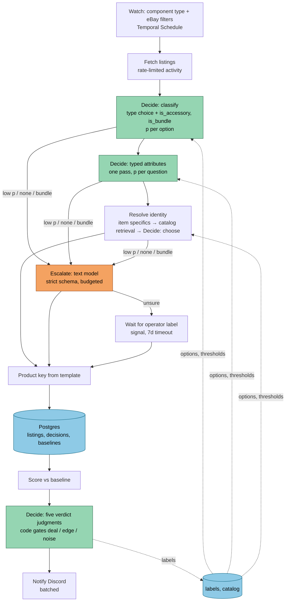

<!-- markdownlint-disable-file MD025 MD041 -->

# RFC-0001: spt: durable execution of typed decisions over watched eBay listings

<!--toc:start-->
<!-- markdownlint-capture -->
<!-- markdownlint-disable MD013 -->
- [Summary](#summary)
- [Problem Statement](#problem-statement)
  - [Supporting Data](#supporting-data)
- [Proposed Solution](#proposed-solution)
  - [Principles](#principles)
  - [Pipeline](#pipeline)
  - [Shape](#shape)
  - [Delivery](#delivery)
- [Alternatives Considered](#alternatives-considered)
- [Risks and Mitigations](#risks-and-mitigations)
- [Success Criteria](#success-criteria)
- [References](#references)
<!-- markdownlint-restore -->
<!--toc:end-->

<!--docz:summary:start-->
## Summary

spt finds underpriced used server hardware on eBay. An operator declares
**watches** (a component type plus eBay filters). spt continuously fetches
matching listings, turns each listing into a **typed record** (component
type, typed attributes, a canonical product key) where every attribute is a
decision with a calibrated probability, prices the record against a
**baseline** of comparable active listings, judges whether it is a deal, and
notifies the operator. Listings the system cannot settle wait for the
operator; the operator's labels and catalog approvals are the data that makes
the system better.

Every listing's journey is a **durable execution**: one workflow history
that survives restarts, retries external calls, rate-limits itself, waits
for humans, and can be opened and read. The domain (component types,
questions, options, thresholds, key templates) is **data**, not code, so
teaching spt a new kind of hardware is a registry entry, catalog rows and
labels.

<!--docz:summary:end-->

<!--docz:problem:start-->
## Problem Statement

Used enterprise hardware (servers, CPUs, RAM, drives, GPUs, NICs,
workstations) is sold on eBay in volume, with wide price dispersion for the
same part, by sellers who describe it inconsistently. A good deal is visible
for hours. A person cannot watch the whole market; a naive price alert
cannot tell a bare chassis from a configured server, a lot of eight DIMMs
from one, or a Tesla P40 from a "P40-compatible" cable.

A system that does this well has to:

1. **Watch continuously** within eBay's per-second and per-day API limits,
   and never lose its place when it restarts.
2. **Understand each listing**: decide the component type, its typed
   attributes and its canonical identity from a title, item specifics and a
   price, with enough confidence to act and an honest signal when it is not
   sure.
3. **Price it**: compare against what the same product currently sells for,
   which means a stable product key and a baseline that forgets listings
   that are gone.
4. **Judge and notify**: fire on real deals, suppress noise, and deliver
   within chat-webhook limits.
5. **Learn from the operator** without a code change: an uncertain listing
   becomes a label; an unknown model becomes a catalog row; thresholds are
   set from measured accuracy, not guessed.
6. **Be operable by one person**: "where is listing X", "why did it decide
   that", "what is stuck" and "what did I spend" must each be one screen.

The hard parts are that listings are unstructured and adversarial (seller
text can be wrong or injected), models are non-deterministic and their
self-reported confidence is not trustworthy, every step talks to a
rate-limited or billed external service, and the work for one listing can
span days when a human is in the loop.

### Supporting Data

Three earlier efforts inform this design. They are referenced as evidence,
not as sources to copy from.

**server-price-tracker** (2026, v0.11.0, archived by its own ADR-0001) built
the whole pipeline and proved the edges: eBay Browse and Analytics clients,
a Postgres store, a Discord notifier with bucket-aware rate limiting, a
composite scorer, OpenTelemetry and Langfuse tracing, a golden dataset with
a regression runner, Helm and a release train. Its middle did not hold. It
asked a text model free-form questions and then compensated in Go every
time the model misbehaved: by its last release, roughly 9,400 lines across
39 files of regex pre-classifiers, normalisers, denylists, unit repair and a
GPU family override existed to correct the model rather than to express the
domain. Adding a component type touched eight code sites and a migration.
Its execution plane was hand-built (cron scheduler, DB-backed queue,
DB-backed token bucket, judge budget loop) with state in five polled tables,
and "why is this listing stuck" was a 581-line SQL runbook. Its baseline
refresh left orphan rows whenever key generation changed. Dev and prod shared
one database.

**The first v2 attempt** (2026-05-24 to 06-01, on this repository's earlier
history) chose to rebuild the execution plane by hand again (Postgres tick
loop, Valkey token bucket, advisory-lock leader election) with Valkey,
Meilisearch and ClickHouse alongside. It finished a solid foundation
(hclkit configuration, OpenTelemetry bootstrap, health endpoints, a Goose
migrator, an eBay mock server with fault injection) and stopped before any
pipeline code existed. The lesson is that the execution plane is not where
this project's novelty is and should not be built.

**repo-guardian and boop** (2026) run on the homelab's self-hosted Temporal
and show that a Go service with per-entity durable workflows, activities for
every external call, signals from an API role, schedules, worker versioning,
and a React SPA behind a Bun BFF with OIDC is a known, operable shape on this
cluster.

**What changed in the model landscape**: decision models (TypeSafe AI's Jev)
return one of a declared option set with a calibrated per-question
probability, in one pass, in under a second, and cannot emit free text.
Frontier models enforce JSON schema at decode time. Together they make
"a value that is not an option" an implementation bug rather than a
normalisation case.

<!--docz:problem:end-->

<!--docz:proposal:start-->
## Proposed Solution

### Principles

1. **If a question has a finite answer set, it is a decision.** The system
   asks a decision model, gets one of the declared options with a
   probability, and branches on the probability. It never inspects or
   repairs the returned text. If the answer set is open (a model name, a
   part number), it is narrowed to a finite set by data first (item
   specifics, catalog retrieval) and then it is a decision. Only when
   narrowing fails is a text model called, and its output is validated like
   a decision. (ADR-0001)
2. **Every listing is a durable execution.** Fetching, deciding, resolving,
   persisting, scoring, judging, notifying and waiting for a human are steps
   in one workflow with declared timeouts, retries and budgets. No table
   exists to be polled. Postgres holds what the business knows; Temporal
   holds what the system is doing. (ADR-0002)
3. **The domain is data.** Component types, their questions, options,
   thresholds, derived fields and product-key templates are a registry file
   whose hash versions every decision. Canonical identities (server models,
   CPU SKUs, GPU models) are a catalog the system grows by proposal and the
   operator grows by approval. (ADR-0003, ADR-0004)
4. **Probabilities are measured, not trusted.** Every decision is stored
   with its probability; every operator action is a label; the calibration
   of predicted probability against observed accuracy is a first-class
   report, and thresholds are set from it.
5. **One operator, one screen per question.** An API with a typed contract
   and a UI with an alert list, a why panel, a review queue, a catalog
   review page, a runs view and a calibration page. (ADR-0006, ADR-0007)
6. **Boring infrastructure.** HCL configuration, the same Temporal plumbing
   and UI shape as the other services on the cluster, one Helm chart, one
   release train. (ADR-0005)

### Pipeline

Green stages are typed decisions. Orange is the only free-text model call
and it runs on the escalation tail under a budget. Blue is data that grows.
Nothing in the green stages is written per component type.

### Shape

- **One Go binary, two roles.** `spt api` serves the OpenAPI contract,
  starts and signals workflows and answers visibility queries. `spt worker`
  hosts workflows and activities on named task queues with per-queue
  concurrency and rate limits. `spt all` runs both for development.
- **One Bun process** serves the operator UI and holds the OIDC session.
- **Postgres** (CNPG on the cluster) is the system of record: watches,
  listings, decisions, labels, catalog, proposals, baselines, alerts, quota
  and budget counters.
- **Temporal** (the cluster's) is the execution plane: a Schedule per watch,
  an `IngestWorkflow` per tick, an `ExtractWorkflow` per listing keyed on
  the eBay item ID and the registry version, `BaselineWorkflow` hourly,
  `CatalogReviewWorkflow` daily.
- **Models**: Jev as the primary decider, Claude with constrained output as
  the fallback and the first to ship, Haiku as the escalation text model,
  Ollama as an optional local decider. All behind one `Decider` contract.
- **Observability**: OpenTelemetry traces per workflow and activity,
  Langfuse sessions per listing with every decision as a generation and
  every label as a score, Prometheus metrics for pipeline semantics and
  Temporal health, dashboards generated from code.

DESIGN-0001 specifies the system, DESIGN-0002 the execution plane,
DESIGN-0003 through DESIGN-0005 the typed-extraction middle (decisions,
registry, catalog), DESIGN-0006 the API and DESIGN-0007 the operator UI.

### Delivery

The build is split so that everything except integration with the cluster
can be verified without a route to the homelab: mockery mocks, recorded
fixtures, an eBay mock server, the Temporal Go SDK test suite and a cached
Temporal CLI dev server. One IMPL document per phase; each task has a
`verify:` line; each session executes a document on a feature branch and
opens a PR.

| Phase | Delivers | Verified by |
| --- | --- | --- |
| 1 Foundation | Repository, configuration, store and migrations, eBay client and mock server, notifier, scorer, observability, health, golden dataset exported into `testdata/` | `just check` green with no services |
| 2 Typed extraction | `Decider` contract and implementations, registry, catalog and resolver, escalator, product keys, regression runner | Golden dataset accuracy and calibration tables |
| 3 Durable execution | Temporal plumbing, workflows, activities, signals, schedules, API role, CLI | SDK test suite, replay tests, dev-server integration tests |
| 4 Integration | Cluster dev namespace, real eBay at a quota cap, live deciders, Langfuse, catalog seeded from the first implementation's data, promotion to prod | Two-week labelled soak: alert precision, escalation rate, agreement |
| 5 Operator UI | BFF, alerts, why panel, review queue, catalog review, runs, calibration | `bun test`, Playwright e2e with axe |

Where an earlier project's code is the obvious starting point for a
foundation piece (the eBay client, the Discord notifier, the hclkit loader,
the Temporal client and worker plumbing, the UI shell and BFF), the IMPL
document names it as a reference. Nothing is imported from those
repositories, and every such piece is re-read against this RFC's
principles before it lands.

<!--docz:proposal:end-->

<!--docz:alternatives:start-->
## Alternatives Considered

- **A text model with constrained output as the whole middle.** Fixes the
  JSON repair problem but not non-determinism across runs (the same GPU is
  "Tesla" one day and "Ampere" the next), gives one self-reported
  confidence rather than a per-question distribution, and costs seconds per
  listing. Kept as the fallback implementation of the decision contract,
  not as the design.
- **A bespoke classifier trained on the golden dataset.** Good for the type
  question and fully local. Does not cover typed attributes, catalog choice
  or verdict without four models and more labels than exist. The `Decider`
  contract leaves room for it later.
- **Component types as code with better structure.** Even a clean
  registry-in-Go still means a release and a review for every new option,
  and the first implementation showed how quickly per-type code accretes
  model workarounds. Data with a validator is the smaller surface.
- **Canonicalisation code instead of a catalog.** Normalising "PowerEdge
  R740XD", "R740xd", "Dell R740 XD" by rules is where the first
  implementation's denylists and overrides came from. A catalog with
  aliases plus a decision over retrieved candidates is data that the
  operator can grow.
- **A hand-built execution plane (cron plus a DB queue plus a token
  bucket), or River, or NATS JetStream.** Each removes some polling but none
  gives per-listing durable state, signals for a human, schedules with
  overlap control, and a history UI. Two earlier attempts built this by hand
  and it was where the operational pain lived. Temporal is already on the
  cluster and runs two other services.
- **Kubernetes CronJobs with a stateless ingest binary.** Removes the
  scheduler; every other piece of state returns to tables.
- **An HTML-over-the-wire UI (templ, HTMX) served by the Go binary.**
  Enough for an alert list, not for a label form, a catalog editor, a runs
  view and charts, and it leaves auth to be invented. The BFF shape already
  exists on the cluster with OIDC, a strict CSP and a write allowlist.
- **A code-first API (Huma).** Ergonomic in Go, but the UI and CLI clients
  need a checked-in contract to generate from, and the other services are
  spec-first.

<!--docz:alternatives:end-->

<!--docz:risks:start-->
## Risks and Mitigations

| Risk | Impact | Likelihood | Mitigation |
| ---- | ------ | ---------- | ---------- |
| Jev becomes unavailable, changes pricing, or a release regresses calibration | No primary decider, or wrong thresholds | Low | The text-model deciders (Anthropic, OpenAI, OpenCode gateway, Ollama) answer the same question sets through one schema; the cascade order is configuration; the regression runner catches a regression before thresholds change |
| Jev calibration is weaker than claimed | Thresholds wrong; noise or silent errors | Medium | Calibration is measured on the golden dataset before thresholds are trusted; the regression runner is a CI gate |
| Jev is hosted and proprietary | Vendor dependency on the primary path | Certain | The contract is vendor-neutral; Claude and Ollama implementations exist from day one |
| The golden dataset exists only in Langfuse | The acceptance gate is lost | Medium | Exported into `testdata/` in phase 1 before any middle code lands |
| Catalog seeding is the real work | Resolver returns 'none of these' too often; escalation rate high | High | Seed from the first implementation's product keys and item-specifics MPNs as proposals; the escalator proposes rows; escalation rate is a first-class metric |
| Per-listing workflow volume | History growth | Low at homelab volume | Children complete and archive; the parent batches notifications; batch per tick above ~100k/day |
| Baseline semantics differ from the first implementation | Thresholds tuned for the old scorer alert on the wrong listings | Medium | Thresholds are set from labels on spt's own alerts over a two-week soak, not carried over |
| Seller text is adversarial | Wrong decisions, injected instructions | Certain | Deciders can only return declared options; the escalator wraps seller content as untrusted data under a strict schema; labels catch the residue |
| A second image and Deployment for the UI | More to build and operate | Certain | The build, image and chart shape already run for repo-guardian |

<!--docz:risks:end-->

<!--docz:criteria:start-->
## Success Criteria

- Classification accuracy on the golden dataset is at least the first
  implementation's on every component type, and per-question calibration
  (predicted probability versus observed accuracy, in ten bins) is
  published with every registry change.
- Fewer than 10% of listings reach the text model after catalog seeding.
- Adding a component type is a registry entry, catalog rows and labels:
  zero Go changes, zero migrations.
- No table exists whose purpose is to be polled. "Where is listing X" and
  "what is stuck" are answered by the runs view or the Temporal UI.
- Baseline refresh leaves no orphan rows.
- Dev and prod have separate databases and Temporal namespaces.
- The operator can label a listing, approve a catalog row and dismiss an
  alert from the UI, and each action appears in that listing's workflow
  history and in the calibration report.
- `just check` passes with no external services; integration tests pass
  against the cached Temporal dev server and a Postgres container.

<!--docz:criteria:end-->

<!--docz:references:start-->
## References

- [ADR-0001 Every finite question is a typed decision with a calibrated probability](../adr/0001-every-finite-question-is-a-typed-decision-with-a-calibrated.md)
- [ADR-0002 Temporal is the execution plane; Postgres is the system of record](../adr/0002-temporal-is-the-execution-plane-postgres-is-the-system-of-record.md)
- [ADR-0003 The domain schema is data: an HCL registry embedded in the binary](../adr/0003-the-domain-schema-is-data-an-hcl-registry-embedded-in-the-binary.md)
- [ADR-0004 Canonical identities come from a catalog grown by proposal and approval](../adr/0004-canonical-identities-come-from-a-catalog-grown-by-proposal-and.md)
- [ADR-0005 Configuration is HCL decoded with hclkit](../adr/0005-configuration-is-hcl-decoded-with-hclkit.md)
- [ADR-0006 The API is a spec-first OpenAPI contract served on net/http](../adr/0006-the-api-is-a-spec-first-openapi-contract-served-on-nethttp.md)
- [ADR-0007 The operator UI is a React SPA behind a Bun BFF](../adr/0007-the-operator-ui-is-a-react-spa-behind-a-bun-bff.md)
- [DESIGN-0001 System architecture](../design/0001-system-architecture-roles-configuration-deployment-and-data.md); [DESIGN-0002 Durable execution](../design/0002-durable-execution-workflows-activities-queues-and-signals.md); [DESIGN-0003 Decisions](../design/0003-decisions-the-decider-contract-cascade-escalation-and.md); [DESIGN-0004 Registry](../design/0004-registry-the-domain-schema-as-an-embedded-hcl-file.md); [DESIGN-0005 Catalog](../design/0005-catalog-canonical-identities-retrieval-and-proposals.md); [DESIGN-0006 API](../design/0006-api-the-openapi-contract-authentication-and-clients.md); [DESIGN-0007 Operator UI](../design/0007-operator-ui-alerts-review-catalog-and-runs.md)
- [server-price-tracker (first implementation)](https://github.com/donaldgifford/server-price-tracker): [CLAUDE.md](https://github.com/donaldgifford/server-price-tracker/blob/main/CLAUDE.md), [ADR-0001 archive v1](https://github.com/donaldgifford/server-price-tracker/blob/docs/architectural-review-investigations/docs/adr/0001-archive-v1-server-price-tracker-greenfield-v2-in-new-repo.md), [DESIGN-0011 alert noise](https://github.com/donaldgifford/server-price-tracker/blob/main/docs/design/0011-reduce-alert-noise-via-scoring-recalibration-and-accessory-pre.md), [DESIGN-0016 observability](https://github.com/donaldgifford/server-price-tracker/blob/main/docs/design/0016-opentelemetry-clickhouse-and-langfuse-instrumentation-for-alert.md), [INV-0001 untrusted content](https://github.com/donaldgifford/server-price-tracker/blob/main/docs/investigation/0001-impl-0019-post-merge-code-review-findings.md)
- The first v2 attempt: the pre-scaffold history of this repository (local checkout `~/code/spt-old`), in particular its INV-0001 (scheduler options) and ADR-0012 (custom scheduler)
- [boop RFC-0001 boopd: run Renovate per repository on Temporal](https://github.com/donaldgifford/boop/blob/main/docs/rfc/0001-boopd-run-renovate-per-repository-on-temporal.md)
- [repo-guardian DESIGN-0026 v2 Temporal control plane and role split](https://github.com/donaldgifford/repo-guardian/blob/main/docs/design/0026-v2-temporal-control-plane-and-role-split.md)
- [homelab ADR-0013 Use self-hosted Temporal for non-infra automation](https://github.com/donaldgifford/homelab/blob/main/docs/adr/0013-use-temporal-self-hosted-for-non-infra-automation.md)
- [TypeSafe AI, Introducing System One Models and Jev](https://typesafe.ai/blog/introducing-system-one-models-and-jev)
- [Claude API, Structured outputs](https://platform.claude.com/docs/en/build-with-claude/structured-outputs)

<!--docz:references:end-->
